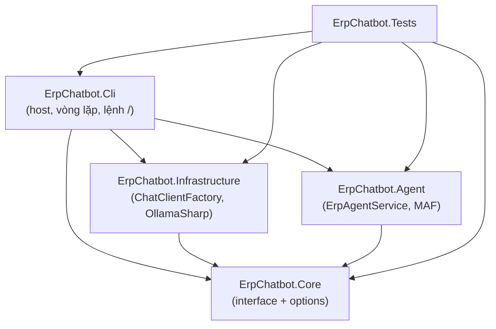
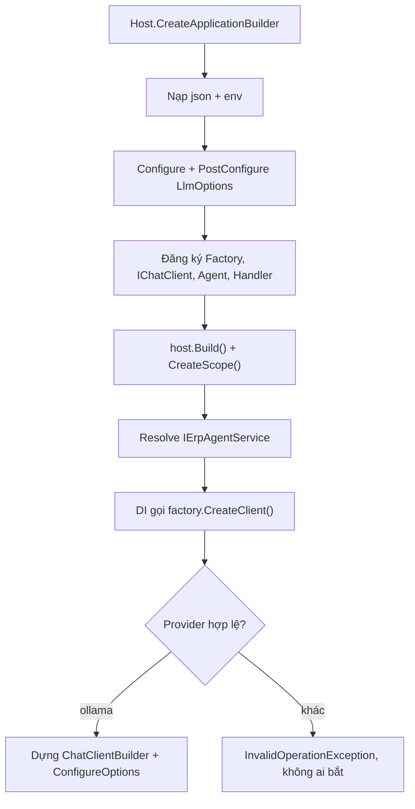
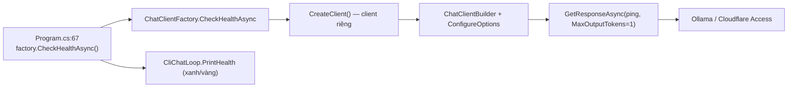
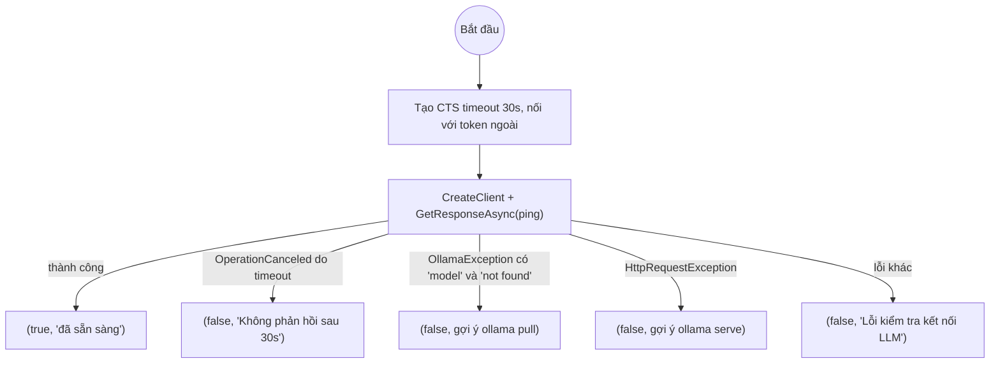
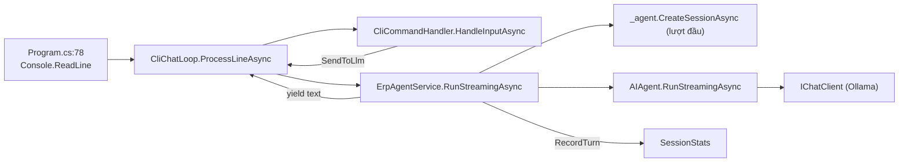
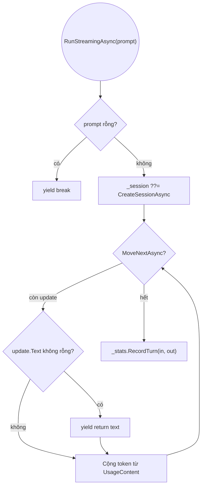
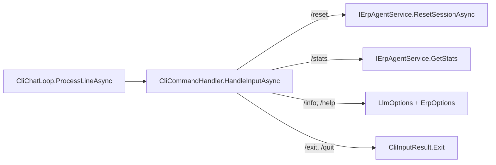
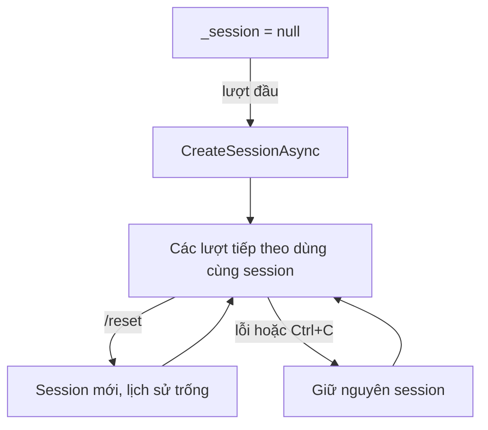
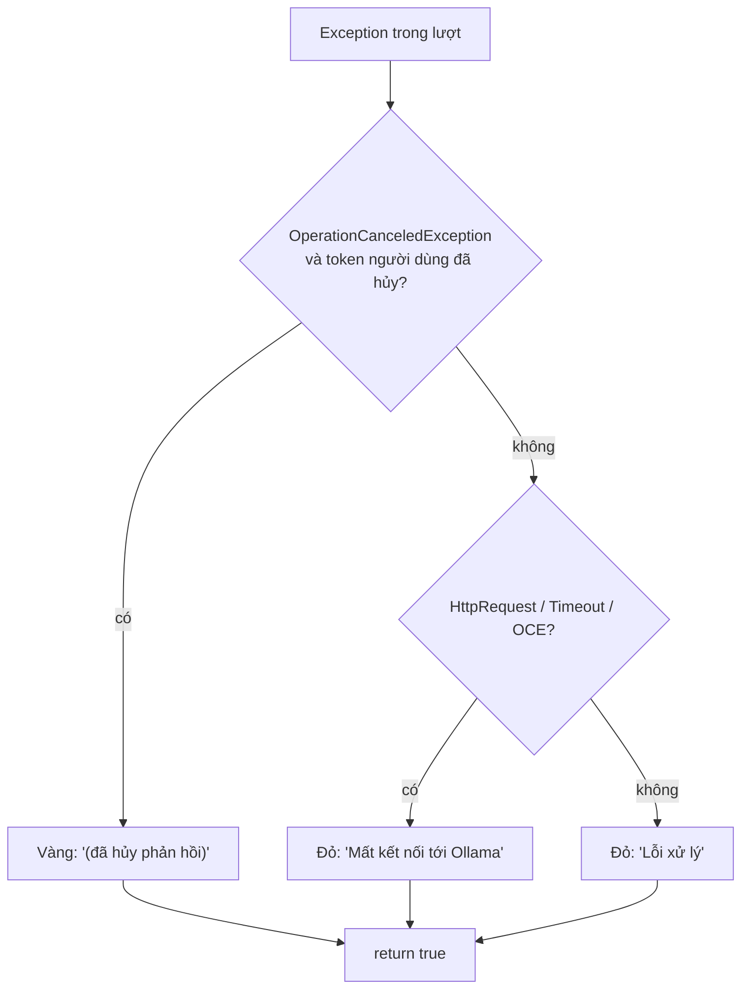

<style>
  @page {
    size: A4;
    margin: 20mm;
    @bottom-right {
      content: "Trang " counter(page) " / " counter(pages);
      font-size: 9pt;
      color: #666;
    }
  }
  .page-break {
    page-break-after: always;
    break-after: page;
  }
  .page-footer {
    display: flex;
    justify-content: space-between;
    font-size: 8.5pt;
    color: #888;
    border-top: 1px solid #e0e0e0;
    padding-top: 4px;
    margin-top: 24px;
  }
</style>

# ErpChatbot — Giai thích codebase giai đoạn Ngày 1

> Phạm vi: toàn bộ thư mục `code/` tại commit `23cd011`. Mọi đường dẫn bên dưới tính từ thư mục `code/`.
> Trạng thái đã kiểm tra: `dotnet test` cho kết quả **29/29 pass** (Failed 0, Skipped 0).
> Chưa kiểm tra: chạy thật với Ollama (cần dịch vụ ngoài).

## Mục lục

1. [Tổng quan kiến trúc](#1-tổng-quan-kiến-trúc) (Trang 1)
2. [Cấu hình & Composition Root](#2-cấu-hình--composition-root) (Trang 2)
3. [Flow 1: Khởi động và health check](#3-flow-1-khởi-động-và-health-check) (Trang 3)
4. [Flow 2: Một lượt chat streaming](#4-flow-2-một-lượt-chat-streaming) (Trang 4)
5. [Flow 3: Lệnh `/` và vòng đời session](#5-flow-3-lệnh--và-vòng-đời-session) (Trang 5)
6. [Flow 4: Hủy lượt và xử lý lỗi](#6-flow-4-hủy-lượt-và-xử-lý-lỗi) (Trang 6)
7. [Kiểm thử](#7-kiểm-thử) (Trang 7)
8. [Điểm lệch, rủi ro, Source Mapping, Analogy](#8-điểm-lệch-rủi-ro-source-mapping-analogy) (Trang 8)

---

## 1. Tổng quan kiến trúc

### Vấn đề là gì?

Cần một chatbot console cho ERP chạy trên Microsoft Agent Framework (MAF), nối được model Ollama (local hoặc qua Cloudflare Access). Giai đoạn này **chưa có dữ liệu ERP**: bot chỉ trò chuyện và từ chối bịa số liệu (prompt ở `src/ErpChatbot.Core/Models/ErpOptions.cs:9-12`). Kiến trúc phải để dành chỗ cho các giai đoạn sau (README nói 7 giai đoạn) mà không phải viết lại.

### CallGraph: phụ thuộc giữa các project



Nguồn: các dòng `ProjectReference` trong `src/*/*.csproj` và `tests/ErpChatbot.Tests/ErpChatbot.Tests.csproj:23-26`.

Hai điểm cần nhớ:
- `Agent` **không** tham chiếu `Infrastructure`. Agent chỉ nhận một `IChatClient` qua constructor, nên không biết model đến từ Ollama hay nơi khác.
- `Core` không phụ thuộc MAF hay OllamaSharp, nhưng có tham chiếu `Microsoft.Extensions.AI.Abstractions 10.10.0` (`ErpChatbot.Core.csproj:10`) vì `IChatClientFactory` trả về `IChatClient`. README ghi "không phụ thuộc thư viện AI bên thứ 3": đúng với MAF và Ollama, chưa chính xác với gói abstraction này.

### Vai trò từng project

| Project | File chính | Vai trò |
|---|---|---|
| `Core` | `Interfaces/IErpAgentService.cs`, `Interfaces/IChatClientFactory.cs`, `Models/*.cs` | Hợp đồng và cấu hình. Không có logic nghiệp vụ, trừ `SessionStats.RecordTurn`. |
| `Infrastructure` | `Factories/ChatClientFactory.cs` | Tạo `IChatClient` cho Ollama, kiểm tra sức khoẻ kết nối. |
| `Agent` | `Services/ErpAgentService.cs` | Bọc `IChatClient` thành `AIAgent`, giữ `AgentSession`, stream text, cộng token. |
| `Cli` | `Program.cs`, `CliRunner.cs`, `appsettings.json` | Nạp cấu hình, lắp DI, vòng lặp nhập liệu, lệnh `/reset /stats /info /exit`. |
| `Tests` | 5 file test | 29 test dùng fake, không cần Ollama. |

### Quy tắc sở hữu trạng thái

`IErpAgentService` ghi rõ: một instance bằng một phiên hội thoại của một người dùng, vì nó giữ `AgentSession` và `SessionStats` làm field (`src/ErpChatbot.Core/Interfaces/IErpAgentService.cs:5-14`). Ở giai đoạn web phải đăng ký Scoped hoặc Keyed, không được Singleton.

<div class="page-footer"><span>ErpChatbot — Codebase Ngày 1</span><span>Trang 1</span></div>
<div class="page-break"></div>

---

## 2. Cấu hình & Composition Root

### Vấn đề là gì?

Provider, model và endpoint phải đổi được mà không sửa code: chạy local, chạy qua tunnel Cloudflare, chạy trong test. Toàn bộ việc lắp ráp nằm ở một nơi, `Program.cs`.

### Thứ tự nạp cấu hình (sau ghi đè trước)

```csharp
// src/ErpChatbot.Cli/Program.cs:18-22
builder.Configuration
    .SetBasePath(AppContext.BaseDirectory)
    .AddJsonFile("appsettings.json", optional: false, reloadOnChange: true)
    .AddJsonFile("appsettings.Local.json", optional: true, reloadOnChange: true) // gitignored: chứa Access token
    .AddEnvironmentVariables();
```

```csharp
// src/ErpChatbot.Cli/Program.cs:28-37
var envProvider = Environment.GetEnvironmentVariable("LLM_PROVIDER");
var envModel = Environment.GetEnvironmentVariable("LLM_MODEL");
var envEndpoint = Environment.GetEnvironmentVariable("OLLAMA_ENDPOINT");

builder.Services.PostConfigure<LlmOptions>(opts =>
{
    if (!string.IsNullOrWhiteSpace(envProvider)) opts.Provider = envProvider;
    if (!string.IsNullOrWhiteSpace(envModel)) opts.Model = envModel;
    if (!string.IsNullOrWhiteSpace(envEndpoint)) opts.Ollama.Endpoint = envEndpoint;
});
```

| Nguồn | Ví dụ | Ghi chú |
|---|---|---|
| Giá trị mặc định trong class | `Model = "llama3.2"`, `Endpoint = "http://localhost:11434"` (`LlmOptions.cs:7-16`) | Dùng khi cấu hình không nói gì. |
| `appsettings.json` | `Model = "llama3.2:3b"`, `Endpoint = "https://ollama.hungnguyen.online"` (`appsettings.json:2-10`) | **Ghi đè** mặc định trong class. |
| `appsettings.Local.json` | `AccessClientId`, `AccessClientSecret` | Bị `.gitignore`; chứa secret Cloudflare Access. |
| Biến `LLM_PROVIDER`, `LLM_MODEL`, `OLLAMA_ENDPOINT` | `LLM_MODEL=llama3.2` | `PostConfigure` chạy sau cùng, thắng mọi nguồn trên. Đọc một lần lúc khởi động. |

### Đăng ký DI

```csharp
// src/ErpChatbot.Cli/Program.cs:41-46
builder.Services.AddSingleton<IChatClientFactory, ChatClientFactory>();
builder.Services.AddSingleton(sp => sp.GetRequiredService<IChatClientFactory>().CreateClient());

// Đăng ký ErpAgentService (1 instance per conversation)
builder.Services.AddScoped<IErpAgentService, ErpAgentService>();
builder.Services.AddScoped<CliCommandHandler>();
```

- `IChatClient` là Singleton, tạo bằng lambda gọi `factory.CreateClient()`.
- `ErpAgentService` là Scoped. Vì `Program.cs:50` tạo **một** scope cho cả vòng đời process, cả ứng dụng dùng chung một instance, tức một cuộc hội thoại.
- `CliChatLoop` **không** vào DI: `Program.cs:71` tạo bằng `new`.

### Flowchart: ai được dựng khi nào



Nhánh `J` là rủi ro số 1 ở mục 8.

<div class="page-footer"><span>ErpChatbot — Codebase Ngày 1</span><span>Trang 2</span></div>
<div class="page-break"></div>

---

## 3. Flow 1: Khởi động và health check

### Vấn đề là gì?

Model có thể chưa nạp, tên model sai, endpoint sai hoặc Ollama treo. Nếu không kiểm tra, người dùng chỉ thấy lỗi ở câu hỏi đầu tiên. `CheckHealthAsync` gửi một câu `ping` ngắn trước khi vào vòng lặp.

### CallGraph



### Code: tạo client

```csharp
// src/ErpChatbot.Infrastructure/Factories/ChatClientFactory.cs:39-50
return _options.Provider.ToLowerInvariant() switch
{
    "ollama" => new ChatClientBuilder(CreateOllamaClient())
        .ConfigureOptions(opt =>
        {
            opt.Temperature ??= _options.Temperature;
            opt.MaxOutputTokens ??= _options.MaxOutputTokens;
        })
        .Build(),
    _ => throw new InvalidOperationException(
        $"LLM_PROVIDER không hợp lệ: '{_options.Provider}'. Ngày 1 chỉ hỗ trợ 'ollama'.")
};
```

`??=` nghĩa là: chỉ điền Temperature và MaxOutputTokens từ cấu hình khi người gọi chưa đặt. Health check đặt `MaxOutputTokens = 1` nên giá trị này được giữ.

### Code: có hoặc không có Cloudflare Access

```csharp
// src/ErpChatbot.Infrastructure/Factories/ChatClientFactory.cs:53-65
var ollama = _options.Ollama;
if (string.IsNullOrWhiteSpace(ollama.AccessClientId) || string.IsNullOrWhiteSpace(ollama.AccessClientSecret))
{
    return new OllamaApiClient(new Uri(ollama.Endpoint), _options.Model);
}

var http = new HttpClient { BaseAddress = new Uri(ollama.Endpoint) };
http.DefaultRequestHeaders.Add("CF-Access-Client-Id", ollama.AccessClientId);
http.DefaultRequestHeaders.Add("CF-Access-Client-Secret", ollama.AccessClientSecret);
return new OllamaApiClient(http, _options.Model);
```

Thiếu một trong hai giá trị thì gọi thẳng, không gắn header.

### Flowchart: các kết quả của health check



```csharp
// src/ErpChatbot.Infrastructure/Factories/ChatClientFactory.cs:82-91
catch (OperationCanceledException) when (timeoutCts.IsCancellationRequested)
{
    return (false, $"Không phản hồi sau {_timeoutMs / 1000}s. Vui lòng kiểm tra xem Ollama có bị treo không.");
}
// Chỉ lỗi do chính Ollama báo "model ... not found"; 404 chung của endpoint sai là HttpRequestException bên dưới
catch (OllamaException ex) when (ex.Message.Contains("model", StringComparison.OrdinalIgnoreCase) &&
                                 ex.Message.Contains("not found", StringComparison.OrdinalIgnoreCase))
```

Health check **không chặn** ứng dụng: `Program.cs:67-68` chỉ in kết quả (xanh nếu khoẻ, vàng nếu không) rồi vẫn vào vòng lặp.

### Ví dụ

| Tình huống | Kết quả `CheckHealthAsync` |
|---|---|
| Model đã nạp | `(true, "Ollama và model 'llama3.2:3b' đã sẵn sàng kết nối.")` |
| Model chưa pull | `(false, "... không tìm thấy trên Ollama ... 'ollama pull <model>'")` |
| Endpoint sai (404 chung) | `HttpRequestException`, báo lỗi kết nối, không báo thiếu model |
| Model nạp lâu hơn 30s | `(false, "Không phản hồi sau 30s ...")` |

Timeout 30s đến từ constructor mặc định (`ChatClientFactory.cs:16-19`); constructor thứ hai (`:22-30`) cho phép test truyền timeout ngắn và client giả.

<div class="page-footer"><span>ErpChatbot — Codebase Ngày 1</span><span>Trang 3</span></div>
<div class="page-break"></div>

---

## 4. Flow 2: Một lượt chat streaming

### Vấn đề là gì?

Người dùng muốn thấy chữ hiện dần, không chờ cả câu. Đồng thời phải đếm token từng lượt và nhớ ngữ cảnh giữa các lượt. Ba việc này tách thành ba tầng: `CliChatLoop` (hiển thị), `ErpAgentService` (stream + đếm), MAF `AgentSession` (nhớ lịch sử).

### CallGraph



### Code: bọc IChatClient thành agent

```csharp
// src/ErpChatbot.Agent/Services/ErpAgentService.cs:16-25
public ErpAgentService(IChatClient chatClient, IOptions<ErpOptions> erpOptions)
{
    var options = erpOptions.Value;

    // Bọc IChatClient thành AIAgent của Microsoft Agent Framework
    _agent = chatClient.AsAIAgent(
        instructions: options.Instructions,
        name: options.AssistantName
    );
}
```

System prompt đi vào agent một lần ở đây. Về sau mỗi lượt chỉ gửi prompt người dùng.

### Code: vòng đọc stream

```csharp
// src/ErpChatbot.Agent/Services/ErpAgentService.cs:31-46
if (string.IsNullOrWhiteSpace(userPrompt))
{
    yield break;
}

// Tự khởi tạo session nếu là lượt đầu tiên
_session ??= await _agent.CreateSessionAsync(cancellationToken);

long turnInputTokens = 0;
long turnOutputTokens = 0;

var responseStream = _agent.RunStreamingAsync(userPrompt, _session, options: null, cancellationToken: cancellationToken);
await using var enumerator = responseStream.GetAsyncEnumerator(cancellationToken);
```

```csharp
// src/ErpChatbot.Agent/Services/ErpAgentService.cs:66-87
if (!string.IsNullOrEmpty(update.Text))
{
    yield return update.Text;
}

if (update.Contents != null)
{
    foreach (var content in update.Contents)
    {
        if (content is UsageContent usageContent && usageContent.Details != null)
        {
            turnInputTokens += usageContent.Details.InputTokenCount ?? 0;
            turnOutputTokens += usageContent.Details.OutputTokenCount ?? 0;
        }
    }
}
// ... hết vòng lặp:
_stats.RecordTurn(turnInputTokens, turnOutputTokens);
```

### Flowchart



### Ví dụ: hiển thị token lượt này

`CliChatLoop` không lấy token từ stream. Nó lấy tổng trước lượt (`CliRunner.cs:132`), chờ stream xong, rồi trừ (`CliRunner.cs:143`):

| Bước | Giá trị |
|---|---|
| `prevTotalTokens` trước lượt | 120 |
| `RecordTurn(60, 40)` sau stream | tổng mới 220 |
| Dòng in ra | `Token lượt này: 100 \| Token tích luỹ: 220` |

Hệ quả: nếu lượt bị hủy, `RecordTurn` không chạy, "token lượt này" sẽ là 0 (xem mục 6).

<div class="page-footer"><span>ErpChatbot — Codebase Ngày 1</span><span>Trang 4</span></div>
<div class="page-break"></div>

---

## 5. Flow 3: Lệnh `/` và vòng đời session

### Vấn đề là gì?

Người dùng cần điều khiển phiên (xoá lịch sử, xem thống kê, thoát) mà không tốn lượt gọi model. `CliCommandHandler` chặn các dòng bắt đầu bằng `/` và trả về một giá trị `CliInputResult` để vòng lặp quyết định.

### CallGraph



### Bảng: input thành kết quả

| Input | `CliInputResult` | Tác dụng phụ | Dòng |
|---|---|---|---|
| rỗng hoặc toàn khoảng trắng | `Ignored` | không | `CliRunner.cs:40-43` |
| `/exit`, `/quit` (không phân biệt hoa thường) | `Exit` | không | `:45-49` |
| `/reset` | `Handled` | gọi `ResetSessionAsync`, in thông báo | `:51-56` |
| `/stats` | `Handled` | in số lượt và token | `:58-67` |
| `/info`, `/help` | `Handled` | in persona, provider, model, endpoint | `:69-80` |
| bất kỳ dòng nào bắt đầu bằng `/` còn lại | `Handled` | in cảnh báo lệnh không hợp lệ | `:82-86` |
| còn lại | `SendToLlm` | không | `:88` |

### Code: reset giữ thống kê

```csharp
// src/ErpChatbot.Agent/Services/ErpAgentService.cs:90-95
public async Task ResetSessionAsync()
{
    // Tạo một session mới hoàn toàn, dọn dẹp ngữ cảnh cũ
    _session = await _agent.CreateSessionAsync();
    // LƯU Ý: Không reset _stats vì stats thống kê toàn bộ phiên làm việc của người dùng
}
```

`/reset` xoá **ngữ cảnh**, giữ **thống kê**. Test `ResetSessionAsync_CreatesNewSession_RetainsSessionStats` khoá hành vi này.

### Flowchart: vòng đời session



### Ghi chú về class `SessionStats`

```csharp
// src/ErpChatbot.Core/Models/SessionStats.cs:10-15
public void RecordTurn(long inputTokens, long outputTokens)
{
    TurnCount++;
    TotalInputTokens += inputTokens;
    TotalOutputTokens += outputTokens;
}
```

Setter là `private`, chỉ `RecordTurn` thay đổi được trạng thái. `TurnCount` tăng ngay cả khi model không trả `UsageContent` (token cộng 0).

<div class="page-footer"><span>ErpChatbot — Codebase Ngày 1</span><span>Trang 5</span></div>
<div class="page-break"></div>

---

## 6. Flow 4: Hủy lượt và xử lý lỗi

### Vấn đề là gì?

Ctrl+C khi bot đang trả lời chỉ nên dừng lượt đó, không tắt ứng dụng, và không làm mất cuộc hội thoại. Lỗi mạng cũng không được làm sập vòng lặp.

### Code: token hủy theo từng lượt

```csharp
// src/ErpChatbot.Cli/Program.cs:81-96
using var turnCts = new CancellationTokenSource();
ConsoleCancelEventHandler cancelHandler = (_, e) =>
{
    e.Cancel = true; // Không tắt app, chỉ cancel lượt stream hiện tại
    turnCts.Cancel();
};
Console.CancelKeyPress += cancelHandler;

try
{
    if (!await chatLoop.ProcessLineAsync(rawInput, turnCts.Token)) break;
}
finally
{
    Console.CancelKeyPress -= cancelHandler;
}
```

Handler chỉ gắn **sau** `ReadLine` (dòng 78) và gỡ ra khi lượt xong. Hệ quả đọc từ code: Ctrl+C lúc bot đang trả lời chỉ hủy lượt; Ctrl+C lúc đang ở dấu nhắc `Bạn:` dùng xử lý mặc định của console và thoát process.

### Code: ba tầng catch

```csharp
// src/ErpChatbot.Cli/CliRunner.cs:147-159
catch (OperationCanceledException) when (userCancellation.IsCancellationRequested)
{
    WriteLine(ConsoleColor.Yellow, "\n(đã hủy phản hồi)");
}
catch (Exception ex) when (ex is HttpRequestException or TimeoutException or OperationCanceledException)
{
    // OperationCanceledException tới đây là timeout của HttpClient, không phải user hủy
    WriteLine(ConsoleColor.Red, $"\n[Mất kết nối tới Ollama: {ex.Message}. Thử lại hoặc gõ /reset]");
}
catch (Exception ex)
{
    WriteLine(ConsoleColor.Red, $"\n[Lỗi xử lý: {ex.Message}]");
}
```

Thứ tự catch quan trọng: `OperationCanceledException` do người dùng bấm Ctrl+C khớp catch đầu (vì `userCancellation.IsCancellationRequested`); `OperationCanceledException` do `HttpClient` hết giờ không thoả điều kiện `when` nên rơi xuống catch thứ hai và được báo là mất kết nối.

### Flowchart



Cả ba nhánh đều `return true`: vòng lặp tiếp tục và `_session` được giữ nguyên.

### Điều cần biết về `ErpAgentService`

```csharp
// src/ErpChatbot.Agent/Services/ErpAgentService.cs:59-64
catch
{
    // Khi xảy ra Exception hoặc CancelKeyPress giữa chừng:
    // KHÔNG reset _session! Để nguyên session để người dùng không bị mất ngữ cảnh đã trao đổi trước đó.
    throw;
}
```

Khối này chỉ `throw;` lại, nên có hay không đều không đổi hành vi. Session được giữ vì không có dòng nào gán lại `_session`, không phải nhờ khối catch. Hai test `...WhenClientThrowsException_DoesNotResetSession` và `...WhenCanceledMidStream_DoesNotResetSession` kiểm chứng kết quả.

Thống kê khi hủy: `RecordTurn` (`:87`) nằm sau vòng lặp, nên lượt bị hủy hoặc lỗi **không** được ghi vào `/stats`.

<div class="page-footer"><span>ErpChatbot — Codebase Ngày 1</span><span>Trang 6</span></div>
<div class="page-break"></div>

---

## 7. Kiểm thử

### Vấn đề là gì?

Không thể yêu cầu Ollama chạy cho mỗi lần `dotnet test`. Cả bộ test dùng fake `IChatClient` và fake `IErpAgentService`, nên chạy trong khoảng 300 ms (lần chạy `29/29`, Duration 306 ms).

### Bảng: 29 test theo nhóm

| File | Số test | Hành vi được khoá |
|---|---|---|
| `Agent/ErpAgentServiceTests.cs` | 7 | Thứ tự stream; giữ ngữ cảnh qua nhiều lượt; cộng token từ `UsageContent`; reset giữ stats; không reset session khi lỗi hoặc hủy; hai cuộc hội thoại cách ly nhau |
| `Cli/CliChatLoopTests.cs` | 5 | Lỗi mạng giữa stream; timeout `HttpClient` không bị nhầm là người dùng hủy; người dùng hủy; `/exit`; `PrintHealth` khi không khoẻ |
| `Cli/CliCommandTests.cs` | 6 | `/reset`, `/stats`, `/exit`, `/info`, lệnh `/` không hợp lệ, input rỗng: không lệnh nào gọi LLM |
| `Core/CoreModelsTests.cs` | 3 | Giá trị mặc định `LlmOptions` và `ErpOptions`; `SessionStats` cộng dồn |
| `Infrastructure/ChatClientFactoryTests.cs` | 8 | Tạo client Ollama; provider không hỗ trợ; health: khoẻ, thiếu model, timeout, không kết nối, 404 chung; client có header Access |

Số lượng lấy bằng cách đếm `[Fact]` trong `tests/`: 7 + 5 + 6 + 3 + 8 = 29, khớp kết quả `dotnet test`.

### Hạ tầng test đáng chú ý

```csharp
// tests/ErpChatbot.Tests/Cli/ConsoleCollection.cs:5-7
// Console.SetOut là global state, nên các test đọc Console.Out không được chạy song song.
[CollectionDefinition("Console", DisableParallelization = true)]
public class ConsoleCollection;
```

Các test CLI gom vào collection `Console` để không giẫm lên nhau khi chuyển hướng `Console.Out`.

### Chưa có test cho

- `Program.cs` (composition root): không test nào dựng host, nên rủi ro số 1 ở mục 8 chưa bị bắt.
- Chạy thật với Ollama: README tự nêu automated tests không thay thế kiểm tra thật.
- Đường dẫn cấu hình: thứ tự `appsettings.json` → `Local` → biến môi trường.

<div class="page-footer"><span>ErpChatbot — Codebase Ngày 1</span><span>Trang 7</span></div>
<div class="page-break"></div>

---

## 8. Điểm lệch, rủi ro, Source Mapping, Analogy

### Điểm lệch giữa tài liệu và code

| README nói | Code thực tế |
|---|---|
| `LLM_MODEL` mặc định `llama3.2` | `appsettings.json:4` đặt `llama3.2:3b`; `llama3.2` chỉ là mặc định trong class `LlmOptions` |
| `OLLAMA_ENDPOINT` mặc định `http://localhost:11434` | `appsettings.json:8` đặt `https://ollama.hungnguyen.online` |
| "28 test cases" | 29 test, đã chạy xác nhận |
| Core "không phụ thuộc thư viện AI bên thứ 3" | Core tham chiếu `Microsoft.Extensions.AI.Abstractions` |

Tên file `CliRunner.cs` không khớp nội dung: file chứa `CliInputResult`, `CliCommandHandler`, `CliChatLoop` (`CliRunner.cs:8,16,92`).

### Rủi ro và việc nên làm

| # | Vấn đề | Vị trí | Gợi ý |
|---|---|---|---|
| 1 | `LLM_PROVIDER` sai làm app sập trước health check: resolve agent kéo theo `CreateClient()`, `InvalidOperationException` không ai bắt | `Program.cs:54`, `ChatClientFactory.cs:48-49` | Bắt lỗi trong `Program.cs` và in thông báo; hoặc kiểm tra provider trước khi resolve |
| 2 | Lượt bị hủy hoặc lỗi không vào `/stats` | `ErpAgentService.cs:87` | Quyết định có tính token dở dang hay không; ghi rõ trong spec |
| 3 | `catch { throw; }` dư | `ErpAgentService.cs:59-64` | Xoá try/catch, giữ comment ở chỗ khác |
| 4 | `ChatTurnResponse` không được dùng ở đâu | `Core/Models/ChatTurnResponse.cs:3-10` | Xoá hoặc dùng ở giai đoạn sau |
| 5 | `AccessClientSecret` nằm ở config dạng chữ thường | `LlmOptions.cs:19`, `appsettings.Local.json` | Giữ file ngoài git; ghi chú trong README cách tạo |
| 6 | Ctrl+C ở dấu nhắc `Bạn:` thoát process | `Program.cs:78-87` | Có thể chủ ý; nếu không, gắn handler một lần ngoài vòng lặp |

Chưa xác minh: việc MAF `AgentSession` có giữ câu trả lời dở sau khi hủy lượt (logic nằm trong thư viện `Microsoft.Agents.AI`, repo không có code).

### Bảng tổng hợp Source Mapping

| File | Layer | Vai trò kỹ thuật |
|---|---|---|
| `src/ErpChatbot.Core/Interfaces/IChatClientFactory.cs` | Core | Hợp đồng tạo `IChatClient` và health check |
| `src/ErpChatbot.Core/Interfaces/IErpAgentService.cs` | Core | Hợp đồng hội thoại; ghi quy tắc sở hữu session |
| `src/ErpChatbot.Core/Models/LlmOptions.cs` | Core | Cấu hình LLM và `OllamaOptions` (endpoint, Access token) |
| `src/ErpChatbot.Core/Models/ErpOptions.cs` | Core | Persona và system prompt |
| `src/ErpChatbot.Core/Models/SessionStats.cs` | Core | Đếm lượt và token |
| `src/ErpChatbot.Core/Models/ChatTurnResponse.cs` | Core | Record chưa được dùng |
| `src/ErpChatbot.Infrastructure/Factories/ChatClientFactory.cs` | Infrastructure | Dựng client Ollama, header Access, health check |
| `src/ErpChatbot.Agent/Services/ErpAgentService.cs` | Agent | `AIAgent`, `AgentSession`, stream, token |
| `src/ErpChatbot.Cli/Program.cs` | Cli | Composition root, banner, vòng lặp, Ctrl+C |
| `src/ErpChatbot.Cli/CliRunner.cs` | Cli | Phân loại input, in kết quả, bắt lỗi theo lượt |
| `src/ErpChatbot.Cli/appsettings.json` | Cli | Cấu hình mặc định khi chạy |
| `tests/ErpChatbot.Tests/**` | Test | 29 test bằng fake, không cần dịch vụ ngoài |

### Analogy: một quán ăn

| Thành phần | Vai trong quán |
|---|---|
| `Program.cs` | Chủ quán: thuê người, xếp bàn, mở cửa |
| `CliChatLoop` | Nhân viên phục vụ: nhận lời khách, bưng món ra từng chút một |
| `CliCommandHandler` | Lễ tân: "báo tính tiền", "đổi bàn" xử lý tại quầy, không vào bếp |
| `ErpAgentService` | Bếp trưởng: giữ sổ order của bàn (session) và đếm nguyên liệu đã dùng (token) |
| `ChatClientFactory` | Nhà cung cấp: nối bếp với kho nguyên liệu (Ollama), kèm thẻ ra vào (Cloudflare Access) |
| Health check | Gọi điện hỏi bếp "hôm nay có mở không?" trước khi đón khách |
| `/reset` | Lật sang tờ order mới, nhưng sổ nguyên liệu vẫn cộng dồn |

<div class="page-footer"><span>ErpChatbot — Codebase Ngày 1</span><span>Trang 8</span></div>
