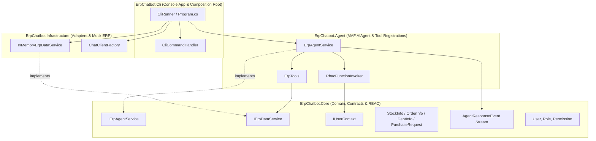

# Design Document: Ngày 2 — Tích hợp Function Calling, Phân quyền RBAC & Duyệt Phê duyệt (MAF Chatbot ERP)

- **Ngày tạo**: 2026-10-28
- **Tác giả**: Nguyen Thanh Hung & Antigravity
- **Dự án**: MAF-Chatbot ERP
- **Trạng thái**: Chờ người dùng nghiệm thu (Pending User Review). Đã qua `/plan-eng-review` ngày 2026-10-29, các quyết định D3–D9 và xử lý lộ lỗi đã được gộp vào tài liệu này; mục §6 liệt kê điểm còn mở.
- **Tài liệu căn cứ**: `tutorial/ngay-02/` (`Ngay-02-Function-calling.pdf`, `giai-thich-ngay-02-function-calling.md`, các bài mẫu Ex1–Ex4).

---

## 1. Bối cảnh & Mục tiêu

### 1.1. Bối cảnh từ Ngày 2
Trong Ngày 1, Chatbot ERP chỉ giao tiếp và trả lời *"Tôi chưa có dữ liệu ERP"*. Ngày 2 đưa chatbot bước sang giai đoạn có dữ liệu nghiệp vụ thật sự bằng kỹ thuật **Function Calling**:
- **Ex1**: Vòng lặp thủ công (`FunctionCallContent`, `FunctionResultContent`, `CallId`).
- **Ex2**: Tự động hóa qua middleware `UseFunctionInvocation()` và trích xuất `response.Messages`, token `Usage`.
- **Ex3**: Tích hợp nhiều tool đọc (`get_stock`, `get_order_status`, `list_low_stock`), cấu hình middleware an toàn (`MaximumIterationsPerRequest = 5`, `MaximumConsecutiveErrorsPerRequest = 2`, `IncludeDetailedErrors = false`, `FunctionInvoker` đo ms và log), trả lời streaming.
- **Ex4**: Nâng cấp lên Microsoft Agent Framework (MAF `ChatClientAgent`), bọc tool ghi (`create_purchase_request`) bằng `ApprovalRequiredAIFunction`, yêu cầu người dùng phê duyệt (`ToolApprovalRequestContent`, hỏi `y/n`) trước khi thực thi ghi dữ liệu.
- **Các bài tập mở rộng được chọn**:
  - Bổ sung tool tra cứu công nợ khách hàng `get_customer_debt`.
  - Phân quyền người dùng theo chuẩn **NIST RBAC** (Role-Based Access Control) ngăn chặn vai trò `Sales` tra cứu công nợ.
  - Phê duyệt có điều kiện (Conditional Approval): ngưỡng `ErpOptions.AutoApproveQuantityThreshold`, **mặc định 0 = luôn hỏi người dùng** (chốt 2026-11-18, §6.3). Đặt 50 để tự duyệt khi tổng số lượng trong lượt `<= 50`, chỉ hỏi khi `> 50`.

### 1.2. Mục tiêu kiến trúc
1. **Bảo tồn Clean Architecture**:
   - `ErpChatbot.Core`: Chứa abstractions, models, event definitions, DTOs, interfaces. Không phụ thuộc thư viện AI bên ngoài (trừ `Microsoft.Extensions.AI.Abstractions`).
   - `ErpChatbot.Infrastructure`: Triển khai `IErpDataService` (`InMemoryErpDataService`) và `IChatClientFactory` (tạo client cơ sở và health check ping). Hoàn toàn không phụ thuộc nghiệp vụ Agent hay `IUserContext`.
   - `ErpChatbot.Agent`: Đóng gói `AIAgent`, cấu hình middleware `UseFunctionInvocation`, invoker `RbacFunctionInvoker`, định nghĩa các `AIFunction`, quản lý vòng đời hội thoại và điều phối event stream. **Agent hoàn toàn không phụ thuộc Infrastructure**.
   - `ErpChatbot.Cli`: Composition Root kết nối toàn bộ hệ thống qua Dependency Injection, hiển thị console stream và xử lý tương tác duyệt người dùng.
2. **Event-Driven Streaming**:
   - `IErpAgentService.RunStreamingAsync` phát ra luồng sự kiện `AgentResponseEvent` (`AgentTextChunkEvent`, `AgentToolExecutionEvent`, `AgentApprovalRequiredEvent`, `AgentTurnCompletedEvent`) bằng cách service tạo event từ chính stream của agent (`FunctionCallContent` + `FunctionResultContent`, ghép theo `CallId`, xem §3.6 mục 4). Hợp đồng event tái sử dụng được cho Web API / SignalR / SSE ở Giai đoạn 4; riêng luồng duyệt xem giới hạn ở §6.1.
3. **An toàn & Bảo mật (Fail-Secure & Defense-in-Depth)**:
   - Chặn lặp vô hạn (tối đa 5 vòng lặp: `MaximumIterationsPerRequest = 5`).
   - Chặn ngắt lỗi liên tiếp (`MaximumConsecutiveErrorsPerRequest = 2`), ẩn lỗi nội bộ (`IncludeDetailedErrors = false`).
   - **Fail-Secure (Default Deny)**: Bất kỳ tool nào chưa đăng ký quyền hạn trong `ToolPermissions` đều bị từ chối mặc định.
   - **Xử lý lỗi có cấu trúc**: Trả về object lỗi có cấu trúc (`error = "PermissionDenied"`) thay vì ném exception gây crash stream hay bị che giấu bởi `IncludeDetailedErrors`.
   - **Không lộ lỗi nội bộ**: `AgentToolExecutionEvent.Error` khi tool ném exception chỉ mang hằng số `RbacFunctionInvoker.ToolFailedMessage` (`"Tool gặp lỗi khi thực thi."`); exception đầy đủ chỉ ghi vào log server qua `ILogger`.
   - **Kiểm tra quyền trước khi xin duyệt**: Người dùng thiếu quyền `PurchaseRequest:Create` sẽ bị từ chối ngay lập tức, tuyệt đối không bị hiển thị prompt hỏi duyệt trên giao diện.
   - **Kiểm soát ngưỡng & chặn đầu vào**: Validate số lượng `quantity > 0` ở cả `ErpAgentService` (quyết định auto-duyệt) lẫn `IErpDataService.CreatePurchaseRequestAsync` (chốt chặn cuối). Auto-duyệt chỉ khi `quantity` trong khoảng 1..ngưỡng và tổng cộng dồn trong một lượt (turn) không vượt ngưỡng, để chặn lách bằng nhiều cuộc gọi nhỏ. Ngưỡng cấu hình qua `ErpOptions.AutoApproveQuantityThreshold` (mặc định `50`), không hard-code.
   - **Cô lập phiên hội thoại**: Lệnh `/user` bắt buộc làm mới session (`ResetSessionAsync()`) để ngăn lộ dữ liệu nhạy cảm (công nợ) qua lịch sử chat.
4. **Kiểm thử độc lập & Xác thực thực tế**:
   - Bộ unit tests với Fake `IChatClient` và in-memory data, kiểm thử toàn diện các nhánh RBAC, Conditional Approval, Fail-Secure, và Streaming Events mà không cần Ollama.
   - Kèm kịch bản smoke test thủ công trên Ollama thật (`llama3.2:3b`) để xác nhận độ tin cậy tương tác tool thật.

---

## 2. Kiến trúc Hệ thống & Phân tầng (.NET 10)



### 2.1. Nâng cấp Package Dependencies
- `Microsoft.Agents.AI`: Nâng cấp lên `1.25.0` (hỗ trợ đầy đủ `ApprovalRequiredAIFunction`, `ToolApprovalRequestContent`, `ToolApprovalResponseContent`).
- `Microsoft.Extensions.AI`: Nâng cấp lên `10.11.0`.
- `Microsoft.Extensions.AI.Abstractions`: `10.11.0`.

---

## 3. Thiết kế Chi tiết các Phân hệ

### 3.1. Hệ thống RBAC Chuẩn Doanh nghiệp (`ErpChatbot.Core/Models/Rbac/`)

Mô hình dựa trên tiêu chuẩn NIST RBAC với Granular Permissions:

#### Permissions (`Permissions.cs`):
```csharp
public static class ErpPermissions
{
    public const string InventoryRead = "Inventory:Read";
    public const string OrdersRead = "Orders:Read";
    public const string DebtRead = "Debt:Read";
    public const string PurchaseRequestCreate = "PurchaseRequest:Create";
}
```

#### Roles & Users:
- **`Role`**:
  - `Sales`: Có quyền `Inventory:Read`, `Orders:Read`, `PurchaseRequest:Create`. *(Không có quyền `Debt:Read`)*.
  - `Accountant`: Có quyền `Debt:Read`, `Inventory:Read`, `Orders:Read`. *(Không có quyền `PurchaseRequest:Create`)*.
  - `Admin`: Sở hữu toàn bộ quyền hạn.
- **`User`**:
  - `Id`, `Username`, `FullName`, `IReadOnlyList<Role> Roles`, `IReadOnlySet<string> EffectivePermissions`.
- **Mock Users**:
  - `sales_user` (Nguyễn Văn Bán - Nhân viên kinh doanh): Role `Sales`.
  - `accountant_user` (Trần Thị Kế Toán - Kế toán công nợ): Role `Accountant`.
  - `admin_user` (Lê Quản Trị - Quản trị viên hệ thống): Role `Admin`.

#### Ngữ cảnh người dùng (`IUserContext`):
```csharp
public interface IUserContext
{
    User CurrentUser { get; }
    void SwitchUser(string username);
    bool HasPermission(string permission);
}
```

---

### 3.2. Dữ liệu Nghiệp vụ & Dịch vụ ERP (`IErpDataService`)

#### Models/DTOs (`ErpChatbot.Core/Models/ErpDataModels.cs`):
- `StockInfo(string ProductCode, string ProductName, int Quantity, string Unit, string Location = "Kho Hà Nội")`
- `OrderStatusInfo(string OrderCode, string Customer, string Status, string Eta)`
- `CustomerDebtInfo(string CustomerCode, string CustomerName, decimal DebtAmount, string Currency = "VND", string DueDate = "")`
- `PurchaseRequestResult(string RequestId, string ProductCode, int Quantity, string Status)`

#### Hợp đồng dịch vụ (`IErpDataService.cs`):
```csharp
public interface IErpDataService
{
    Task<StockInfo> GetStockAsync(string productCode, CancellationToken ct = default);
    Task<OrderStatusInfo> GetOrderStatusAsync(string orderCode, CancellationToken ct = default);
    Task<IReadOnlyList<StockInfo>> ListLowStockAsync(int threshold, CancellationToken ct = default);
    Task<CustomerDebtInfo> GetCustomerDebtAsync(string customerCode, CancellationToken ct = default);
    Task<PurchaseRequestResult> CreatePurchaseRequestAsync(string productCode, int quantity, CancellationToken ct = default);
}
```

#### Cài đặt trong bộ nhớ (`InMemoryErpDataService.cs`):
- Dữ liệu tồn kho:
  - `SP-001`: Bàn phím cơ K87 (124 cái)
  - `SP-002`: Chuột không dây M3 (8 cái)
  - `SP-003`: Màn hình 27 inch Q27 (3 chiếc)
  - `SP-004`: Cáp HDMI 2m (560 sợi)
- Dữ liệu đơn hàng:
  - `DH-1001`: Công ty An Phát (Đang giao, 2026-10-23)
  - `DH-1002`: Cửa hàng Minh Long (Chờ xuất kho, 2026-10-25)
- Dữ liệu công nợ:
  - `KH-001`: Công ty TNHH Ánh Dương (45.000.000 VND, Hạn: 2026-11-15)
  - `KH-002`: Đại lý Hoàng Gia (120.500.000 VND, Quá hạn: 2026-10-30)
  - `KH-003`: Doanh nghiệp Song Toàn (0 VND)
- Đề xuất mua hàng: Validate `quantity > 0` (ngăn chặn số âm/bằng 0). Sinh mã ngẫu nhiên `PR-xxxx`, trạng thái *"Chờ phê duyệt của trưởng phòng mua hàng"*.

---

### 3.3. Định nghĩa Tools trong MAF (`ErpChatbot.Agent/Tools/ErpTools.cs`)

Định nghĩa 5 tools rõ ràng, có `[Description]` chi tiết và hỗ trợ lọc danh sách theo quyền của người dùng hiện tại (Defense-in-Depth):
1. `get_stock(productCode)`: Tra cứu số lượng tồn kho sản phẩm (Quyền: `Inventory:Read`).
2. `get_order_status(orderCode)`: Tra cứu trạng thái đơn bán hàng (Quyền: `Orders:Read`).
3. `list_low_stock(threshold)`: Liệt kê các sản phẩm có tồn kho thấp hơn ngưỡng (Quyền: `Inventory:Read`).
4. `get_customer_debt(customerCode)`: Tra cứu công nợ khách hàng (Quyền: `Debt:Read`).
5. `create_purchase_request(productCode, quantity)`: Tạo đề xuất mua hàng (Quyền: `PurchaseRequest:Create`, bọc bằng `ApprovalRequiredAIFunction`).

Hàm `ErpTools.GetTools(erpDataService, userContext)` cho phép lọc chỉ trả về các tools mà `userContext.CurrentUser` có quyền thực thi.

---

### 3.4. Hệ thống Sự kiện Stream (`AgentResponseEvent`)

```csharp
public abstract record AgentResponseEvent;

public record AgentTextChunkEvent(string Text) : AgentResponseEvent;

public record AgentToolExecutionEvent(
    string ToolName, 
    string ArgumentsSummary, 
    long ElapsedMs, 
    bool Success, 
    string? Error = null) : AgentResponseEvent;

public record AgentApprovalRequiredEvent(
    string ToolName, 
    IReadOnlyDictionary<string, object?> Arguments, 
    string Summary) : AgentResponseEvent;

public record AgentTurnCompletedEvent(
    long InputTokens, 
    long OutputTokens, 
    long ElapsedMs) : AgentResponseEvent;
```

---

### 3.5. Quy trình Điều phối & Duyệt Phê duyệt (`ErpAgentService.cs`)

```mermaid
sequenceDiagram
    autonumber
    actor User as Người dùng CLI
    participant Service as ErpAgentService
    participant Agent as AIAgent (MAF)
    participant Invoker as RbacFunctionInvoker
    participant Erp as InMemoryErpDataService

    User->>Service: RunStreamingAsync(prompt, approvalHandler)
    Service->>Agent: RunStreamingAsync(prompt, session)
    
    alt Tool đọc (get_stock / get_order_status / get_customer_debt)
        Agent->>Invoker: Gọi tool qua middleware
        Invoker->>Invoker: Kiểm tra quyền (Fail-Secure)
        alt Thiếu quyền hoặc tool lạ
            Invoker-->>Agent: Trả structured error { error = "PermissionDenied", message = "..." }
            Agent-->>Service: Stream câu trả lời giải thích không có quyền
        else Đủ quyền
            Invoker->>Erp: Thực thi truy vấn
            Erp-->>Invoker: Trả kết quả DTO
            Invoker-->>Agent: Trả kết quả
            Agent-->>Service: Stream câu trả lời chứa số liệu thật
        end
    else Tool ghi (create_purchase_request)
        Agent-->>Service: Phát hiện ToolApprovalRequestContent
        Note over Service: BƯỚC 1: Kiểm tra quyền RBAC trước!
        alt User THIẾU quyền PurchaseRequest:Create
            Service->>Service: Tự động từ chối (approved = false) - KHÔNG hỏi user!
            Service->>Agent: Gửi ToolApprovalResponseContent(approved: false)
            Agent-->>Service: Stream thông báo người dùng không có quyền
        else User CÓ quyền PurchaseRequest:Create
            Note over Service: BƯỚC 2: Kiểm tra tính hợp lệ & Ngưỡng duyệt
            alt quantity <= 0 (Không hợp lệ)
                Service->>Service: approved = false
                Service->>Agent: Gửi ToolApprovalResponseContent(approved: false)
            else quantity > 0 && cumulativeTurnQuantity + quantity <= threshold (Tự động duyệt; threshold mặc định 0 nên thực tế luôn hỏi)
                Service->>Service: approved = true, cộng dồn turn quantity
                Service->>Agent: Gửi ToolApprovalResponseContent(approved: true)
                Agent->>Invoker: Thực thi ghi vào ERP
                Invoker->>Erp: Tạo phiếu PR-xxxx
                Erp-->>Invoker: PurchaseRequestResult
                Agent-->>Service: Stream câu trả lời tạo thành công
            else cumulativeTurnQuantity + quantity > 50 (Cần duyệt)
                alt approvalHandler == null
                    Service->>Service: approved = false (Mặc định từ chối an toàn)
                else approvalHandler != null
                    Service->>User: approvalHandler(AgentApprovalRequiredEvent)
                    User-->>Service: Phản hồi duyệt (y/n)
                end
                Service->>Agent: Gửi ToolApprovalResponseContent(approved)
                alt approved = true
                    Service->>Service: cộng dồn turn quantity
                    Agent->>Invoker: Thực thi ghi vào ERP
                    Agent-->>Service: Stream thông báo đã tạo đề xuất
                else approved = false
                    Agent-->>Service: Stream thông báo đề xuất bị từ chối
                end
            end
        end
    end
    Service-->>User: AgentTurnCompletedEvent
```

---

### 3.6. Cấu hình Middleware An toàn & Invoker (`ErpAgentService.cs`)

Trong tầng `ErpChatbot.Agent`, client được bọc bởi `UseFunctionInvocation` trước khi tạo `AIAgent`:

```csharp
var clientWithFunctions = new ChatClientBuilder(rawChatClient)
    .UseFunctionInvocation(configure: f =>
    {
        f.MaximumIterationsPerRequest = 5;          // Chặn loop vô hạn
        f.MaximumConsecutiveErrorsPerRequest = 2;   // Ngắt nếu lỗi liên tiếp 2 lần
        f.IncludeDetailedErrors = false;            // Ẩn lỗi nhạy cảm
        f.AllowConcurrentInvocation = false;        // Chạy tuần tự

        f.FunctionInvoker = RbacFunctionInvoker.CreateInvoker(userContext, logger);
    })
    .Build();
```

Trong `RbacFunctionInvoker.cs`:
1. **Fail-Secure (Default Deny)**: Nếu tool không có trong `ToolPermissions`, từ chối ngay lập tức.
2. **Structured Error Return**: Khi từ chối, trả về `{ error = "PermissionDenied", message = "..." }` thay vì throw exception, giúp LLM nhận và giải thích rõ ràng cho người dùng mà không bị ngắt stream bởi `MaximumConsecutiveErrorsPerRequest`.
3. **Che lỗi nội bộ**: `CreateInvoker(IUserContext, ILogger?)`. Khi tool ném exception, invoker gọi `logger?.LogError(ex, "Tool {Tool} lỗi khi thực thi", toolName)` rồi `throw;` (giữ nguyên để `FunctionInvokingChatClient` vẫn đếm lỗi liên tiếp). Event `AgentToolExecutionEvent` do service dựng từ stream (mục 4) chỉ mang `ToolFailedMessage`, nên `ex.Message` không đi vào event.
   - `ToolFailedMessage` là `const string` = `"Tool gặp lỗi khi thực thi."`.
   - `ILogger<ErpAgentService>` do DI tiêm vào constructor (tham số tuỳ chọn, mặc định null để test không bắt buộc truyền). Lưu ý: console logger mặc định của `Host.CreateApplicationBuilder` in cả stack trace ra cửa sổ chat, xem §6.1.
   - Giới hạn còn lại: `ArgumentsSummary` vẫn chứa giá trị tham số do mô hình sinh; chấp nhận được ở CLI, cần che bớt khi lên Web.
4. **Đường đi của event tool: tạo từ stream (đã làm)** (căn cứ: research 2026-11-15 và spike `Tests/Agent/ToolEventsFromStreamSpikeTests.cs` chạy với `Microsoft.Agents.AI` 1.25.0 + fake client)
   - **Luồng**: `FunctionInvokingChatClient` chạy tool; stream của agent mang `FunctionCallContent` (tên, tham số, `CallId`) rồi `FunctionResultContent` cùng `CallId`. `ErpAgentService.RunStreamingAsync` ghép hai loại theo `CallId` và `yield return AgentToolExecutionEvent` ngay khi thấy result, trước text kế tiếp. Không còn hàng đợi hay state dùng chung giữa invoker và service; invoker chỉ kiểm quyền, ghi log và trả kết quả.
   - **Quy tắc dựng event**: `Success = (Exception == null && Result is not ToolSecurityError)`; `Error` = `ToolSecurityError.Message` (từ chối quyền), `ToolFailedMessage` (tool lỗi) hoặc null. Tuyệt đối không lấy `Exception.Message` hay chuỗi `Result` của lỗi: spike xác nhận `FunctionResultContent.Exception.Message` giữ nguyên chuỗi gốc (có SQL).
   - **Phiếu bị từ chối ở bước duyệt**: framework vẫn phát `FunctionResultContent` với chuỗi "rejected by the approver" và `Exception == null`; service nhớ `CallId` bị từ chối (`skipResultCallIds`) để không báo nhầm là đã thực thi. Event từ chối do service tự tạo (thiếu quyền, số lượng <= 0) giữ nguyên.
   - **Nhánh tự duyệt không còn event "ok" giả**: event thật tới từ stream, nên không còn trường hợp CLI in `ok` rồi `LỖI` cho cùng một phiếu.
   - **`ElapsedMs`**: stream không mang thời gian chạy; service đo từ lúc thấy `FunctionCallContent` đến lúc thấy `FunctionResultContent` (xấp xỉ, gồm overhead middleware). Với tool ghi cần duyệt, `FunctionCallContent` chỉ xuất hiện ở stream sau khi duyệt, nên không tính thời gian chờ người dùng.
   - **Kết quả thành công trong stream là `JsonElement`** (đã serialize), không phải DTO; muốn hiển thị chi tiết thì parse JSON.
   - **Hành vi framework đã ghi lại thành test** (8 test spike): thành công; tool ném lỗi; bị invoker từ chối; tool ghi chờ duyệt (chỉ có `ToolApprovalRequestContent`); sau khi duyệt; sau khi từ chối; hai call trong một update; hai yêu cầu duyệt trong một message.
   - **Phương án đã loại**: callback in thẳng ra Console (kiểu Ex3) vì Agent sẽ phụ thuộc UI và không dùng lại được cho Web; `ConcurrentQueue`/`Channel<T>` vì cần state dùng chung và gây rủi ro event cũ lọt sang lượt sau (đã gặp khi huỷ lúc tool đang chạy).
   - **Giới hạn**: spike dùng fake client, chưa kiểm với Ollama thật (chunking thật có thể khác) và chưa kiểm nhiều vòng duyệt liên tiếp.

---

### 3.7. Trải nghiệm & Lệnh CLI (`ErpChatbot.Cli`)
- **Lệnh điều khiển phiên**:
  - `/user <username>`: Chuyển đổi giữa `sales_user`, `accountant_user`, `admin_user`. **Bắt buộc tự động gọi `ResetSessionAsync()`** để dọn sạch lịch sử phiên, bảo mật tuyệt đối dữ liệu giữa các người dùng.
  - `/whoami`: Hiển thị thông tin người dùng đang đăng nhập, các Role và Permissions.
  - `/reset`: Bắt đầu phiên hội thoại mới, dọn sạch session nhưng bảo lưu tổng token.
  - `/stats`: Hiển thị số lượt chat và token sử dụng.
  - `/info`: Xem cấu hình hệ thống và danh sách lệnh.
  - `/exit`: Thoát chương trình.
- **Tương tác Phê duyệt**:
  Khi phát sinh `AgentApprovalRequiredEvent`:
  ```
     [cần duyệt] create_purchase_request(productCode=SP-003, quantity=100). Đồng ý? (y/n): 
  ```
  Nhập `y` / `Y` -> duyệt; bất kỳ ký tự nào khác (hoặc Enter) -> từ chối an toàn.

---

## 4. Chiến lược Kiểm thử (Testing Strategy)

Toàn bộ test suites sử dụng xUnit, FluentAssertions, và Fake `IChatClient` (không cần Ollama thật):

| Test Suite | File Kiểm thử | Trọng tâm kiểm thử |
|---|---|---|
| **Core RBAC** | `Tests/Core/UserContextTests.cs` | - Quyền hạn của `Sales`, `Accountant`, `Admin`.<br/>- Hàm `SwitchUser` và `HasPermission`. |
| **Core DTOs** | `Tests/Core/ErpDataModelsTests.cs` | - Khởi tạo và tính toàn vẹn của DTOs và Event records. |
| **Infrastructure ERP** | `Tests/Infrastructure/InMemoryErpDataServiceTests.cs` | - Tra tồn kho SP-001, lỗi SP-999.<br/>- Tra đơn DH-1001.<br/>- Lọc hàng sắp hết threshold = 10.<br/>- Tra công nợ KH-001, KH-002.<br/>- Tạo PR-xxxx thành công; throw lỗi khi quantity <= 0. |
| **Agent Tools** | `Tests/Agent/ErpToolsTests.cs` | - Metadata của 5 tools (Name, Description, Parameters).<br/>- Tool ghi được bọc bởi `ApprovalRequiredAIFunction`.<br/>- Lọc danh sách tools theo quyền người dùng. |
| **RBAC Security** | `Tests/Agent/RbacFunctionInvokerTests.cs` | - Fail-Secure: Tool không đăng ký bị từ chối.<br/>- Thiếu quyền: Trả structured error thay vì crash.<br/>- Đủ quyền: Thực thi thành công và ghi log sự kiện.<br/>- Tool ném exception chứa chuỗi nội bộ (vd `SELECT * FROM Items`): event có `Success=false`, `Error == ToolFailedMessage`, không chứa chuỗi gốc; `ILogger` giả nhận đúng exception gốc. |
| **Conditional Approval** | `Tests/Agent/ConditionalApprovalTests.cs` | - `quantity <= 0` -> Không auto-duyệt.<br/>- `quantity > 0 && <= 50` -> Tự động duyệt.<br/>- `quantity > 50` -> Yêu cầu người dùng duyệt.<br/>- Tích luỹ nhiều lần gọi trong một lượt vượt ngưỡng 50 -> Yêu cầu duyệt.<br/>- User thiếu quyền `PurchaseRequest:Create` -> Bị từ chối ngay, không phát sinh event hỏi duyệt. |
| **Agent Service Streaming** | `Tests/Agent/ErpAgentServiceTests.cs` | - Phát các event chunk và event hoàn tất lượt.<br/>- Tạo `AgentToolExecutionEvent` từ `FunctionResultContent` trong stream, đúng thứ tự (trước text kế tiếp); hai call trong một update → hai event đúng `ToolName`/`ArgumentsSummary`.<br/>- `ResetSessionAsync` không làm mất `SessionStats`.<br/>- `approvalHandler == null` mặc định từ chối. |
| **Approval → ERP (tích hợp)** | `Tests/Agent/ErpAgentServiceTests.cs` (Fake `IChatClient` + `InMemoryErpDataService` thật) | - Auto-duyệt (≤ ngưỡng) → resume → PR-xxxx được tạo thật trong ERP.<br/>- Người dùng từ chối (`n`) → ERP KHÔNG tăng số PR.<br/>- Hai yêu cầu duyệt trong một lượt → cộng dồn qua vòng `while`, yêu cầu thứ hai vượt ngưỡng thì hỏi duyệt.<br/>- Tool ném exception → `AgentToolExecutionEvent(Success=false)`. |
| **Event tool không lọt lượt sau** | `Tests/Agent/ErpAgentServiceTests.cs` | - Huỷ (Ctrl+C) khi tool đang chạy (ERP giả ném `OperationCanceledException`) → lượt kế tiếp KHÔNG phát lại event của lượt trước (hồi quy: không còn state dùng chung giữa các lượt). |
| **Event tool từ stream** | `Tests/Agent/ErpAgentServiceTests.cs` (`ToolEvent_*`, `Approval_*`) | - Tool ném exception (qua duyệt hoặc không): event `Success=false`, `Error == ToolFailedMessage`, không chứa `SELECT`.<br/>- Người dùng từ chối → KHÔNG có event thực thi nào (không báo nhầm thành công).<br/>- Bị invoker từ chối quyền → event `Success=false`, `Error` chứa tên quyền.<br/>- Auto-duyệt → đúng MỘT event thành công cho `create_purchase_request`. |
| **Hành vi stream của framework (spike)** | `Tests/Agent/ToolEventsFromStreamSpikeTests.cs` | - 8 ca ghi lại `ChatClientAgent` 1.25.0 phát gì: call/result, `Exception`, `ToolSecurityError`, `ToolApprovalRequestContent`, stream sau duyệt/từ chối, nhiều call. Nếu nâng cấp package làm hỏng các test này thì phải xem lại cách dựng event. |
| **Cô lập phiên (tích hợp)** | `Tests/Cli/CliCommandHandlerTests.cs` | - Sau `/user` đổi sang role khác, session thật không còn chứa kết quả công nợ của lượt trước. |
| **CLI Commands** | `Tests/Cli/CliCommandHandlerTests.cs` | - `/user` tự động gọi reset session.<br/>- `/whoami`, `/reset`, `/stats`, `/info`. |

---

## 5. Ranh giới Phạm vi (Scope Boundaries)

### Thuộc phạm vi Ngày 2 (IN SCOPE):
- Tích hợp 4 tool đọc (`get_stock`, `get_order_status`, `list_low_stock`, `get_customer_debt`) và 1 tool ghi (`create_purchase_request`).
- Hệ thống phân quyền RBAC chuẩn (User, Role, Granular Permission).
- Phê duyệt ghi có điều kiện (quantity > ngưỡng `ErpOptions.AutoApproveQuantityThreshold`, mặc định 0 = luôn hỏi) và luồng Event-driven tương tác duyệt trên CLI.
- Cấu hình an toàn middleware (5 vòng lặp, ẩn lỗi nhạy cảm, log thời gian ms).
- Nâng cấp `Microsoft.Agents.AI` lên `1.25.0` và `Microsoft.Extensions.AI` lên `10.11.0`.

### Không thuộc phạm vi Ngày 2 (OUT OF SCOPE / Lùi lại):
- Kết nối cơ sở dữ liệu thật hoặc API ERP .NET Framework legacy (Dành cho Ngày 3).
- Giao thức MCP (Model Context Protocol) Server (Dành cho Ngày 3).
- Web Chat AG-UI / ASP.NET Core API hosting (Dành cho Ngày 4).
- Observability / OpenTelemetry / RAG tài liệu (Dành cho Ngày 5).

---

## 6. Giới hạn đã biết & Smoke test thủ công

### 6.1. Giới hạn đã biết (chưa xử lý trong Ngày 2, ghi nhận từ outside voice review)
- **Idempotency**: `CreatePurchaseRequestAsync` chưa có khoá yêu cầu; timeout/retry sau khi ERP đã tạo phiếu có thể tạo PR trùng. Chuyển sang Ngày 3 khi nối ERP thật.
- **RBAC chỉ là mô phỏng**: `/user` đổi danh tính không xác thực. Không dùng làm nền bảo mật cho Web; quyền phải gắn với danh tính đã xác thực ở Ngày 4.
- **Callback duyệt**: `approvalHandler` chưa hỗ trợ tạm dừng/tiếp tục qua nhiều HTTP request; cần thiết kế lại khi làm SSE/SignalR.
- **Rò rỉ lỗi qua event** (đã xử lý ở §3.6 mục 3): event chỉ mang `ToolFailedMessage`, chi tiết vào log. Còn lại: `ArgumentsSummary` và thông báo từ chối quyền (gồm username, vai trò, tên quyền) vẫn đi vào event; cần che bớt khi lên Web.
- **Ý định ghi & "duyệt"**: auto-duyệt ≤ ngưỡng nghĩa là model tự quyết tạo PR; "y/n" chỉ xác nhận thao tác, còn phiếu vẫn *chờ trưởng phòng mua hàng phê duyệt*. Cần quyết định có giữ auto-duyệt hay không.
- **Event tool từ stream** (xem §3.6 mục 4): đã làm ở Ngày 2, bỏ hàng đợi. Còn lại cho Ngày 4: `FunctionResultContent` thô chứa `Exception` (có SQL) nên không được chuyển nguyên lên Web; chỉ chuyển `AgentToolExecutionEvent`.
- **Lỗi tool lặp lại không còn lộ qua CLI (đã xử lý)**: `CliRunner.cs` (catch cuối) in câu cố định `[Lỗi xử lý yêu cầu. Thử lại hoặc gõ /reset]` thay vì `ex.Message`; có test `ProcessLine_WhenUnexpectedErrorMentionsSql_DoesNotPrintRawMessage`.
- **Console logger đã tắt (đã xử lý)**: `Program.cs` gọi `builder.Logging.ClearProviders()` nên stack trace không còn in ra cửa sổ chat. Hệ quả: hiện chưa có log nào được lưu; Ngày 4 cần thêm log file/server.
- **Middleware trùng**: `ChatClientAgent` có thể tự thêm `FunctionInvokingChatClient` (Ex4 dòng 16); phải xác nhận bằng chạy thật rằng cấu hình `UseFunctionInvocation` ở §3.6 có hiệu lực.

### 6.2. Smoke test thủ công với Ollama thật (`llama3.2:3b`)
1. `sales_user`: "SP-003 còn bao nhiêu?" → gọi `get_stock`, không gọi tool ghi.
2. `sales_user`: "Công nợ KH-001?" → bị từ chối, model giải thích không có quyền.
3. `accountant_user`: "Công nợ KH-002?" → trả 120.500.000 VND.
4. `sales_user`: "Tạo đề xuất mua 20 cái SP-003" → tự duyệt, tạo PR; "mua 100 cái" → hỏi y/n.
5. `/user` đổi role rồi hỏi lại dữ liệu cũ → không còn nhớ kết quả phiên trước.
6. Ghi lại model có gọi nhầm tool ghi cho câu hỏi chỉ đọc hay không.

**Kết quả chạy ngày 2026-11-16** (Ollama VPS, `dotnet run` qua script, dữ liệu mẫu trong bộ nhớ): bước 1, 3, 4, 5, 6 đạt. Bước 2 đạt một phần: không lộ số công nợ nhưng model gọi nhầm `get_order_status` và trả "không tìm thấy" thay vì giải thích thiếu quyền (tool công nợ đã bị lọc khỏi danh sách của `sales_user`). Sau khi tạo phiếu, model tự bịa "đang chờ trưởng phòng phê duyệt". Chưa chạy: từ chối `n`, cộng dồn nhiều phiếu, tool lỗi 3 lần. Ghi chú: `dotnet watch` chỉ chuyển chữ khi có xuống dòng nên không dùng cho script tự động có dấu nhắc `Bạn:` / `(y/n):`.

### 6.3. Phân tích chính sách tự duyệt (Q2) — chờ người dùng quyết định
**Hiện tại**: `create_purchase_request` có số lượng > 0 và (tổng đã tạo trong *một lượt* + lần này) ≤ `AutoApproveQuantityThreshold` (50) thì tạo phiếu ngay, không hỏi. Bộ đếm về 0 ở lượt sau. Ví dụ: "mua 20 cái SP-003" → tạo phiếu luôn (đã quan sát khi smoke test).

| Phương án | Ưu | Nhược | Ai dùng |
|---|---|---|---|
| A. Giữ tự duyệt ≤ 50 mỗi lượt | Ít phiền | Số lượng không phản ánh rủi ro tiền; chia nhỏ qua nhiều lượt để né; model gọi nhầm thì phiếu rác vẫn được tạo | Không tìm thấy hệ thống lớn nào dùng |
| B. Luôn hỏi y/n (ngưỡng = 0) | Chặn model gọi nhầm / prompt injection; gần như không phải sửa code | Hỏi nhiều thì dễ bấm "y" cho xong | MAF `ApprovalRequiredAIFunction`, OpenAI `needs_approval=True`, Claude Code |
| C. Tự duyệt theo ngưỡng *tiền*, cộng dồn theo user và theo ngày | Đúng cách ERP thật làm | Cần đơn giá + nơi lưu bền ở server | Dynamics 365 (spending limit), SAP, Odoo |
| D. Chatbot chỉ tạo phiếu nháp, ERP lo duyệt | Phiếu nhầm chưa có hiệu lực | Cần ERP có trạng thái Nháp | Dynamics 365 (Draft → Approved) |

**Hệ thống khác** (nguồn chính thức trừ khi ghi chú):
- MAF: chọn từng tool cần duyệt bằng `ApprovalRequiredAIFunction`; `AutoApprovalRules` mặc định rỗng. https://learn.microsoft.com/en-us/agent-framework/agents/tools/tool-approval
- OpenAI Agents SDK: `needs_approval` là `True` hoặc hàm theo tham số; không đọc được tham số thì bắt duyệt tay. https://openai.github.io/openai-agents-python/human_in_the_loop/
- OpenAI "A practical guide to building agents": chấm tool low/medium/high theo chỉ đọc/ghi, hoàn tác được không, ảnh hưởng tài chính; việc "sensitive, irreversible, high stakes" cần người giám sát. https://cdn.openai.com/business-guides-and-resources/a-practical-guide-to-building-agents.pdf
- LangChain: `interrupt_on` theo tool, kèm điều kiện `when` theo tham số. https://docs.langchain.com/oss/python/langchain/human-in-the-loop
- Claude Code: mặc định hỏi trước khi sửa file; luật xét deny → ask → allow. https://code.claude.com/docs/en/permissions
- Dynamics 365: phiếu mua đi Draft → Approved; chuyển quản lý khi vượt spending limit của người yêu cầu. https://learn.microsoft.com/en-us/dynamics365/supply-chain/procurement/purchase-requisitions-workflow
- SAP release strategy theo *giá trị tổng*, nhóm vật tư, nhà máy (trang SAP Help bản 4.6C, cũ). Odoo: vượt "Minimum Amount" thì "To Approve" (nguồn bên thứ ba, chưa có tài liệu Odoo chính thức).
- Điểm chung của các ERP: hạn mức tính theo **tiền**, chia cấp theo vai trò, không tính theo số lượng.

**Rủi ro và cách giảm với code hiện tại**:
1. Model gọi nhầm tool / prompt injection (OWASP LLM06 Excessive Agency, https://genai.owasp.org/llmrisk/llm062025-excessive-agency/): đặt ngưỡng mặc định 0; câu hỏi y/n lấy tham số thật từ `FunctionCallContent`, không lấy từ lời model.
2. Chia nhỏ để né hạn mức: bộ đếm hiện chỉ trong một lượt (3 lượt × 50 = 150 cái không bị hỏi). Nếu giữ tự duyệt thì phải cộng dồn theo user và ngày, lưu ở server.
3. Mệt vì bị hỏi nhiều: Anthropic ghi nhận người dùng chấp nhận 93% lần hỏi trong Claude Code (https://www.anthropic.com/engineering/claude-code-auto-mode; số đo trên Claude Code, không phải chatbot ERP). Giảm bằng cách chỉ hỏi ở tool ghi.
4. Thiếu dấu vết: thêm audit log bền (user, tham số, ai duyệt, thời điểm) — Ngày 4.
5. Model bịa trạng thái phiếu: tool nên trả trạng thái rõ ("Đã tạo PR-xxx, không qua duyệt") và prompt dặn chỉ nhắc lại.

**Không chắc**: chưa có tài liệu Odoo chính thức; SAP bản cũ; chưa rõ LangChain xử lý tool không có trong `interrupt_on`; không tìm thấy hệ thống lớn nào dùng ngưỡng số lượng mỗi lượt (không phải bằng chứng rằng không ai dùng).

**Khuyến nghị của researcher**: đổi mặc định sang B (ngưỡng 0) cho v0.1; cân nhắc C hoặc D khi ERP thật có đơn giá và trạng thái Nháp (Ngày 3). **Quyết định (2026-11-18): người dùng chọn "luôn hỏi".** Đã đổi `ErpOptions.DefaultAutoApproveQuantityThreshold` và `appsettings.json` từ 50 xuống 0; test cũ giả định 50 được sửa bằng cách truyền `threshold: 50` / `AutoApproveQuantityThreshold = 50` rõ ràng; thêm test `ShouldRequireApproval_DefaultThreshold_AlwaysAsks`, `Approval_DefaultOptions_AsksUserEvenForSmallQuantity`. Muốn tự duyệt lại thì đặt `Erp:AutoApproveQuantityThreshold`. Việc còn lại (Ngày 3-4): hạn mức theo tiền + cộng dồn theo user/ngày, audit log, tool trả trạng thái phiếu rõ để model không bịa "chờ duyệt".


**Bổ sung 2026-11-18 — model bịa lý do khi người dùng từ chối**: framework chỉ báo cho model "rejected by the approver", nên model 3B tự bịa "trưởng phòng không chấp thuận". Đã xử lý: `ErpAgentService.cs` truyền `req.CreateResponse(approved, rejectReason)` (người dùng từ chối / thiếu quyền / số lượng sai) và thêm một câu dặn vào `Instructions` (`ErpOptions.cs`, `appsettings.json`). Test `Approval_UserRejects_ModelIsToldTheUserRejected` (đỏ trước khi sửa, xanh sau). Đo với Ollama thật, 3 lần bấm `n`: 1 lần nêu đúng "người dùng tự từ chối", 2 lần trả lời chung chung (1 lần gợi ý "liên hệ trưởng phòng") — giảm bịa nhưng model 3B không đảm bảo; dòng `-> Đã từ chối thực thi.` của CLI luôn đúng.
