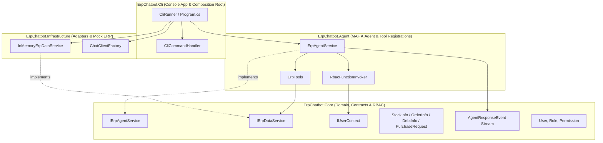
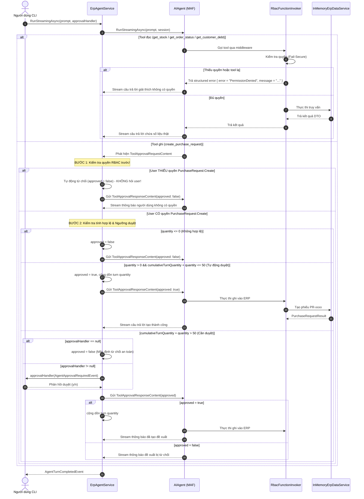

# Design Document: Ngày 2 — Tích hợp Function Calling, Phân quyền RBAC & Duyệt Phê duyệt (MAF Chatbot ERP)

- **Ngày tạo**: 2026-10-28
- **Tác giả**: Nguyen Thanh Hung & Antigravity
- **Dự án**: MAF-Chatbot ERP
- **Trạng thái**: Chờ người dùng nghiệm thu (Pending User Review)
- **Tài liệu căn cứ**: `tutorial/ngay-02/` (`Ngay-02-Function-calling.pdf`, `giai-thich-ngay-02-function-calling.md`, các bài mẫu Ex1–Ex4).

---

## 1. Bối cảnh & Mục tiêu

### 1.1. Bối cảnh từ Ngày 2
Trong Ngày 1, Chatbot ERP chỉ giao tiếp và trả lời *"Tôi chưa có dữ liệu ERP"*. Ngày 2 đưa chatbot bước sang giai đoạn có dữ liệu nghiệp vụ thật sự bằng kỹ thuật **Function Calling**:
- **Ex1**: Vòng lặp thủ công (`FunctionCallContent`, `FunctionResultContent`, `CallId`).
- **Ex2**: Tự động hóa qua middleware `UseFunctionInvocation()` và trích xuất `response.Messages`, token `Usage`.
- **Ex3**: Tích hợp nhiều tool đọc (`get_stock`, `get_order_status`, `list_low_stock`), cấu hình middleware an toàn (`MaximumIterationsPerRequest = 5`, `MaximumConsecutiveErrorsPerRequest = 2`, `IncludeDetailedErrors = false`, `FunctionInvoker` đo ms và log), trả lời streaming.
- **Ex4**: Nâng cấp lên Microsoft Agent Framework (MAF `ChatClientAgent`), bọc tool ghi (`create_purchase_request`) bằng `ApprovalRequiredAIFunction`, yêu cầu người dùng phê duyệt (`ToolApprovalRequestContent`, hỏi `y/n`) trước khi thực thi ghi dữ liệu.
- **Các bài tập mở rộng được chọn**:
  - Bổ sung tool tra cứu công nợ khách hàng `get_customer_debt`.
  - Phân quyền người dùng theo chuẩn **NIST RBAC** (Role-Based Access Control) ngăn chặn vai trò `Sales` tra cứu công nợ.
  - Phê duyệt có điều kiện (Conditional Approval): Tự động duyệt nếu số lượng mua `<= 50`, chỉ hỏi người dùng khi số lượng `> 50`.

### 1.2. Mục tiêu kiến trúc
1. **Bảo tồn Clean Architecture**:
   - `ErpChatbot.Core`: Chứa abstractions, models, event definitions, DTOs, interfaces. Không phụ thuộc thư viện AI bên ngoài (trừ `Microsoft.Extensions.AI.Abstractions`).
   - `ErpChatbot.Infrastructure`: Triển khai `IErpDataService` (`InMemoryErpDataService`) và `IChatClientFactory` (tạo client cơ sở và health check ping). Hoàn toàn không phụ thuộc nghiệp vụ Agent hay `IUserContext`.
   - `ErpChatbot.Agent`: Đóng gói `AIAgent`, cấu hình middleware `UseFunctionInvocation`, invoker `RbacFunctionInvoker`, định nghĩa các `AIFunction`, quản lý vòng đời hội thoại và điều phối event stream. **Agent hoàn toàn không phụ thuộc Infrastructure**.
   - `ErpChatbot.Cli`: Composition Root kết nối toàn bộ hệ thống qua Dependency Injection, hiển thị console stream và xử lý tương tác duyệt người dùng.
2. **Event-Driven Streaming**:
   - `IErpAgentService.RunStreamingAsync` phát ra luồng sự kiện `AgentResponseEvent` (`AgentTextChunkEvent`, `AgentToolExecutionEvent`, `AgentApprovalRequiredEvent`, `AgentTurnCompletedEvent`) thông qua hàng đợi sự kiện an toàn luồng (`ConcurrentQueue`). Sẵn sàng 100% cho Web API / SignalR / SSE ở Giai đoạn 4.
3. **An toàn & Bảo mật (Fail-Secure & Defense-in-Depth)**:
   - Chặn lặp vô hạn (tối đa 5 vòng lặp: `MaximumIterationsPerRequest = 5`).
   - Chặn ngắt lỗi liên tiếp (`MaximumConsecutiveErrorsPerRequest = 2`), ẩn lỗi nội bộ (`IncludeDetailedErrors = false`).
   - **Fail-Secure (Default Deny)**: Bất kỳ tool nào chưa đăng ký quyền hạn trong `ToolPermissions` đều bị từ chối mặc định.
   - **Xử lý lỗi có cấu trúc**: Trả về object lỗi có cấu trúc (`error = "PermissionDenied"`) thay vì ném exception gây crash stream hay bị che giấu bởi `IncludeDetailedErrors`.
   - **Kiểm tra quyền trước khi xin duyệt**: Người dùng thiếu quyền `PurchaseRequest:Create` sẽ bị từ chối ngay lập tức, tuyệt đối không bị hiển thị prompt hỏi duyệt trên giao diện.
   - **Kiểm soát ngưỡng & chặn đầu vào**: Validate số lượng `quantity > 0` và giới hạn ngưỡng tích luỹ mua hàng cộng dồn trong một lượt (turn) để ngăn chặn việc lách ngưỡng bằng nhiều cuộc gọi nhỏ.
   - **Cô lập phiên hội thoại**: Lệnh `/user` bắt buộc làm mới session (`ResetSessionAsync()`) để ngăn lộ dữ liệu nhạy cảm (công nợ) qua lịch sử chat.
4. **Kiểm thử độc lập & Xác thực thực tế**:
   - Bộ unit tests với Fake `IChatClient` và in-memory data, kiểm thử toàn diện các nhánh RBAC, Conditional Approval, Fail-Secure, và Streaming Events mà không cần Ollama.
   - Kèm kịch bản smoke test thủ công trên Ollama thật (`llama3.2:3b`) để xác nhận độ tin cậy tương tác tool thật.

---

## 2. Kiến trúc Hệ thống & Phân tầng (.NET 10)



### 2.1. Nâng cấp Package Dependencies
- `Microsoft.Agents.AI`: Nâng cấp lên `1.25.0` (hỗ trợ đầy đủ `ApprovalRequiredAIFunction`, `ToolApprovalRequestContent`, `ToolApprovalResponseContent`).
- `Microsoft.Extensions.AI`: Nâng cấp lên `10.11.0`.
- `Microsoft.Extensions.AI.Abstractions`: `10.11.0`.

---

## 3. Thiết kế Chi tiết các Phân hệ

### 3.1. Hệ thống RBAC Chuẩn Doanh nghiệp (`ErpChatbot.Core/Models/Rbac/`)

Mô hình dựa trên tiêu chuẩn NIST RBAC với Granular Permissions:

#### Permissions (`Permissions.cs`):
```csharp
public static class ErpPermissions
{
    public const string InventoryRead = "Inventory:Read";
    public const string OrdersRead = "Orders:Read";
    public const string DebtRead = "Debt:Read";
    public const string PurchaseRequestCreate = "PurchaseRequest:Create";
}
```

#### Roles & Users:
- **`Role`**:
  - `Sales`: Có quyền `Inventory:Read`, `Orders:Read`, `PurchaseRequest:Create`. *(Không có quyền `Debt:Read`)*.
  - `Accountant`: Có quyền `Debt:Read`, `Inventory:Read`, `Orders:Read`. *(Không có quyền `PurchaseRequest:Create`)*.
  - `Admin`: Sở hữu toàn bộ quyền hạn.
- **`User`**:
  - `Id`, `Username`, `FullName`, `IReadOnlyList<Role> Roles`, `IReadOnlySet<string> EffectivePermissions`.
- **Mock Users**:
  - `sales_user` (Nguyễn Văn Bán - Nhân viên kinh doanh): Role `Sales`.
  - `accountant_user` (Trần Thị Kế Toán - Kế toán công nợ): Role `Accountant`.
  - `admin_user` (Lê Quản Trị - Quản trị viên hệ thống): Role `Admin`.

#### Ngữ cảnh người dùng (`IUserContext`):
```csharp
public interface IUserContext
{
    User CurrentUser { get; }
    void SwitchUser(string username);
    bool HasPermission(string permission);
}
```

---

### 3.2. Dữ liệu Nghiệp vụ & Dịch vụ ERP (`IErpDataService`)

#### Models/DTOs (`ErpChatbot.Core/Models/ErpDataModels.cs`):
- `StockInfo(string ProductCode, string ProductName, int Quantity, string Unit, string Location = "Kho Hà Nội")`
- `OrderStatusInfo(string OrderCode, string Customer, string Status, string Eta)`
- `CustomerDebtInfo(string CustomerCode, string CustomerName, decimal DebtAmount, string Currency = "VND", string DueDate = "")`
- `PurchaseRequestResult(string RequestId, string ProductCode, int Quantity, string Status)`

#### Hợp đồng dịch vụ (`IErpDataService.cs`):
```csharp
public interface IErpDataService
{
    Task<StockInfo> GetStockAsync(string productCode, CancellationToken ct = default);
    Task<OrderStatusInfo> GetOrderStatusAsync(string orderCode, CancellationToken ct = default);
    Task<IReadOnlyList<StockInfo>> ListLowStockAsync(int threshold, CancellationToken ct = default);
    Task<CustomerDebtInfo> GetCustomerDebtAsync(string customerCode, CancellationToken ct = default);
    Task<PurchaseRequestResult> CreatePurchaseRequestAsync(string productCode, int quantity, CancellationToken ct = default);
}
```

#### Cài đặt trong bộ nhớ (`InMemoryErpDataService.cs`):
- Dữ liệu tồn kho:
  - `SP-001`: Bàn phím cơ K87 (124 cái)
  - `SP-002`: Chuột không dây M3 (8 cái)
  - `SP-003`: Màn hình 27 inch Q27 (3 chiếc)
  - `SP-004`: Cáp HDMI 2m (560 sợi)
- Dữ liệu đơn hàng:
  - `DH-1001`: Công ty An Phát (Đang giao, 2026-10-23)
  - `DH-1002`: Cửa hàng Minh Long (Chờ xuất kho, 2026-10-25)
- Dữ liệu công nợ:
  - `KH-001`: Công ty TNHH Ánh Dương (45.000.000 VND, Hạn: 2026-11-15)
  - `KH-002`: Đại lý Hoàng Gia (120.500.000 VND, Quá hạn: 2026-10-30)
  - `KH-003`: Doanh nghiệp Song Toàn (0 VND)
- Đề xuất mua hàng: Validate `quantity > 0` (ngăn chặn số âm/bằng 0). Sinh mã ngẫu nhiên `PR-xxxx`, trạng thái *"Chờ phê duyệt của trưởng phòng mua hàng"*.

---

### 3.3. Định nghĩa Tools trong MAF (`ErpChatbot.Agent/Tools/ErpTools.cs`)

Định nghĩa 5 tools rõ ràng, có `[Description]` chi tiết và hỗ trợ lọc danh sách theo quyền của người dùng hiện tại (Defense-in-Depth):
1. `get_stock(productCode)`: Tra cứu số lượng tồn kho sản phẩm (Quyền: `Inventory:Read`).
2. `get_order_status(orderCode)`: Tra cứu trạng thái đơn bán hàng (Quyền: `Orders:Read`).
3. `list_low_stock(threshold)`: Liệt kê các sản phẩm có tồn kho thấp hơn ngưỡng (Quyền: `Inventory:Read`).
4. `get_customer_debt(customerCode)`: Tra cứu công nợ khách hàng (Quyền: `Debt:Read`).
5. `create_purchase_request(productCode, quantity)`: Tạo đề xuất mua hàng (Quyền: `PurchaseRequest:Create`, bọc bằng `ApprovalRequiredAIFunction`).

Hàm `ErpTools.GetTools(erpDataService, userContext)` cho phép lọc chỉ trả về các tools mà `userContext.CurrentUser` có quyền thực thi.

---

### 3.4. Hệ thống Sự kiện Stream (`AgentResponseEvent`)

```csharp
public abstract record AgentResponseEvent;

public record AgentTextChunkEvent(string Text) : AgentResponseEvent;

public record AgentToolExecutionEvent(
    string ToolName, 
    string ArgumentsSummary, 
    long ElapsedMs, 
    bool Success, 
    string? Error = null) : AgentResponseEvent;

public record AgentApprovalRequiredEvent(
    string ToolName, 
    IReadOnlyDictionary<string, object?> Arguments, 
    string Summary) : AgentResponseEvent;

public record AgentTurnCompletedEvent(
    long InputTokens, 
    long OutputTokens, 
    long ElapsedMs) : AgentResponseEvent;
```

---

### 3.5. Quy trình Điều phối & Duyệt Phê duyệt (`ErpAgentService.cs`)



---

### 3.6. Cấu hình Middleware An toàn & Invoker (`ErpAgentService.cs`)

Trong tầng `ErpChatbot.Agent`, client được bọc bởi `UseFunctionInvocation` trước khi tạo `AIAgent`:

```csharp
var clientWithFunctions = new ChatClientBuilder(rawChatClient)
    .UseFunctionInvocation(configure: f =>
    {
        f.MaximumIterationsPerRequest = 5;          // Chặn loop vô hạn
        f.MaximumConsecutiveErrorsPerRequest = 2;   // Ngắt nếu lỗi liên tiếp 2 lần
        f.IncludeDetailedErrors = false;            // Ẩn lỗi nhạy cảm
        f.AllowConcurrentInvocation = false;        // Chạy tuần tự

        f.FunctionInvoker = RbacFunctionInvoker.CreateInvoker(userContext, evt => _eventQueue.Enqueue(evt));
    })
    .Build();
```

Trong `RbacFunctionInvoker.cs`:
1. **Fail-Secure (Default Deny)**: Nếu tool không có trong `ToolPermissions`, từ chối ngay lập tức.
2. **Structured Error Return**: Khi từ chối, trả về `{ error = "PermissionDenied", message = "..." }` thay vì throw exception, giúp LLM nhận và giải thích rõ ràng cho người dùng mà không bị ngắt stream bởi `MaximumConsecutiveErrorsPerRequest`.

---

### 3.7. Trải nghiệm & Lệnh CLI (`ErpChatbot.Cli`)
- **Lệnh điều khiển phiên**:
  - `/user <username>`: Chuyển đổi giữa `sales_user`, `accountant_user`, `admin_user`. **Bắt buộc tự động gọi `ResetSessionAsync()`** để dọn sạch lịch sử phiên, bảo mật tuyệt đối dữ liệu giữa các người dùng.
  - `/whoami`: Hiển thị thông tin người dùng đang đăng nhập, các Role và Permissions.
  - `/reset`: Bắt đầu phiên hội thoại mới, dọn sạch session nhưng bảo lưu tổng token.
  - `/stats`: Hiển thị số lượt chat và token sử dụng.
  - `/info`: Xem cấu hình hệ thống và danh sách lệnh.
  - `/exit`: Thoát chương trình.
- **Tương tác Phê duyệt**:
  Khi phát sinh `AgentApprovalRequiredEvent`:
  ```
     [cần duyệt] create_purchase_request(productCode=SP-003, quantity=100). Đồng ý? (y/n): 
  ```
  Nhập `y` / `Y` -> duyệt; bất kỳ ký tự nào khác (hoặc Enter) -> từ chối an toàn.

---

## 4. Chiến lược Kiểm thử (Testing Strategy)

Toàn bộ test suites sử dụng xUnit, FluentAssertions, và Fake `IChatClient` (không cần Ollama thật):

| Test Suite | File Kiểm thử | Trọng tâm kiểm thử |
|---|---|---|
| **Core RBAC** | `Tests/Core/UserContextTests.cs` | - Quyền hạn của `Sales`, `Accountant`, `Admin`.<br/>- Hàm `SwitchUser` và `HasPermission`. |
| **Core DTOs** | `Tests/Core/ErpDataModelsTests.cs` | - Khởi tạo và tính toàn vẹn của DTOs và Event records. |
| **Infrastructure ERP** | `Tests/Infrastructure/InMemoryErpDataServiceTests.cs` | - Tra tồn kho SP-001, lỗi SP-999.<br/>- Tra đơn DH-1001.<br/>- Lọc hàng sắp hết threshold = 10.<br/>- Tra công nợ KH-001, KH-002.<br/>- Tạo PR-xxxx thành công; throw lỗi khi quantity <= 0. |
| **Agent Tools** | `Tests/Agent/ErpToolsTests.cs` | - Metadata của 5 tools (Name, Description, Parameters).<br/>- Tool ghi được bọc bởi `ApprovalRequiredAIFunction`.<br/>- Lọc danh sách tools theo quyền người dùng. |
| **RBAC Security** | `Tests/Agent/RbacFunctionInvokerTests.cs` | - Fail-Secure: Tool không đăng ký bị từ chối.<br/>- Thiếu quyền: Trả structured error thay vì crash.<br/>- Đủ quyền: Thực thi thành công và ghi log sự kiện. |
| **Conditional Approval** | `Tests/Agent/ConditionalApprovalTests.cs` | - `quantity <= 0` -> Không auto-duyệt.<br/>- `quantity > 0 && <= 50` -> Tự động duyệt.<br/>- `quantity > 50` -> Yêu cầu người dùng duyệt.<br/>- Tích luỹ nhiều lần gọi trong một lượt vượt ngưỡng 50 -> Yêu cầu duyệt.<br/>- User thiếu quyền `PurchaseRequest:Create` -> Bị từ chối ngay, không phát sinh event hỏi duyệt. |
| **Agent Service Streaming** | `Tests/Agent/ErpAgentServiceTests.cs` | - Phát các event chunk và event hoàn tất lượt.<br/>- Stream các `AgentToolExecutionEvent` từ hàng đợi ra stream.<br/>- `ResetSessionAsync` không làm mất `SessionStats`.<br/>- `approvalHandler == null` mặc định từ chối. |
| **CLI Commands** | `Tests/Cli/CliCommandHandlerTests.cs` | - `/user` tự động gọi reset session.<br/>- `/whoami`, `/reset`, `/stats`, `/info`. |

---

## 5. Ranh giới Phạm vi (Scope Boundaries)

### Thuộc phạm vi Ngày 2 (IN SCOPE):
- Tích hợp 4 tool đọc (`get_stock`, `get_order_status`, `list_low_stock`, `get_customer_debt`) và 1 tool ghi (`create_purchase_request`).
- Hệ thống phân quyền RBAC chuẩn (User, Role, Granular Permission).
- Phê duyệt ghi có điều kiện (quantity > 50) và luồng Event-driven tương tác duyệt trên CLI.
- Cấu hình an toàn middleware (5 vòng lặp, ẩn lỗi nhạy cảm, log thời gian ms).
- Nâng cấp `Microsoft.Agents.AI` lên `1.25.0` và `Microsoft.Extensions.AI` lên `10.11.0`.

### Không thuộc phạm vi Ngày 2 (OUT OF SCOPE / Lùi lại):
- Kết nối cơ sở dữ liệu thật hoặc API ERP .NET Framework legacy (Dành cho Ngày 3).
- Giao thức MCP (Model Context Protocol) Server (Dành cho Ngày 3).
- Web Chat AG-UI / ASP.NET Core API hosting (Dành cho Ngày 4).
- Observability / OpenTelemetry / RAG tài liệu (Dành cho Ngày 5).
