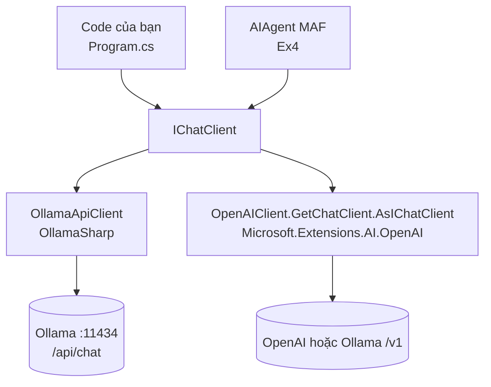
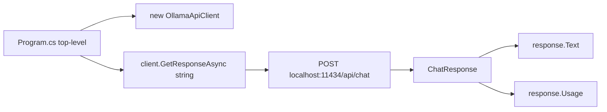
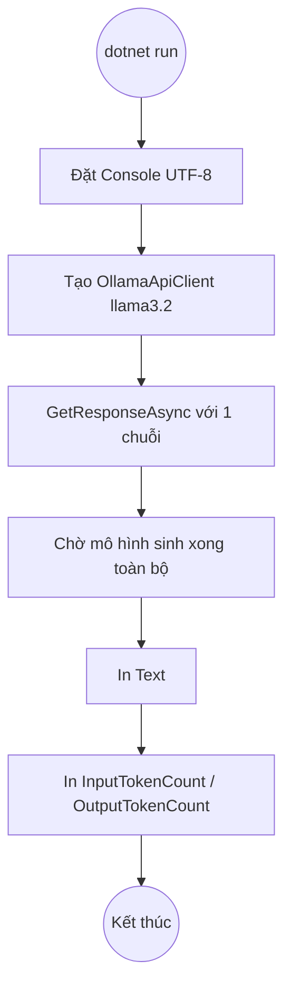
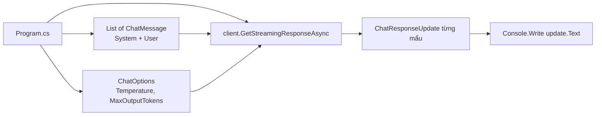
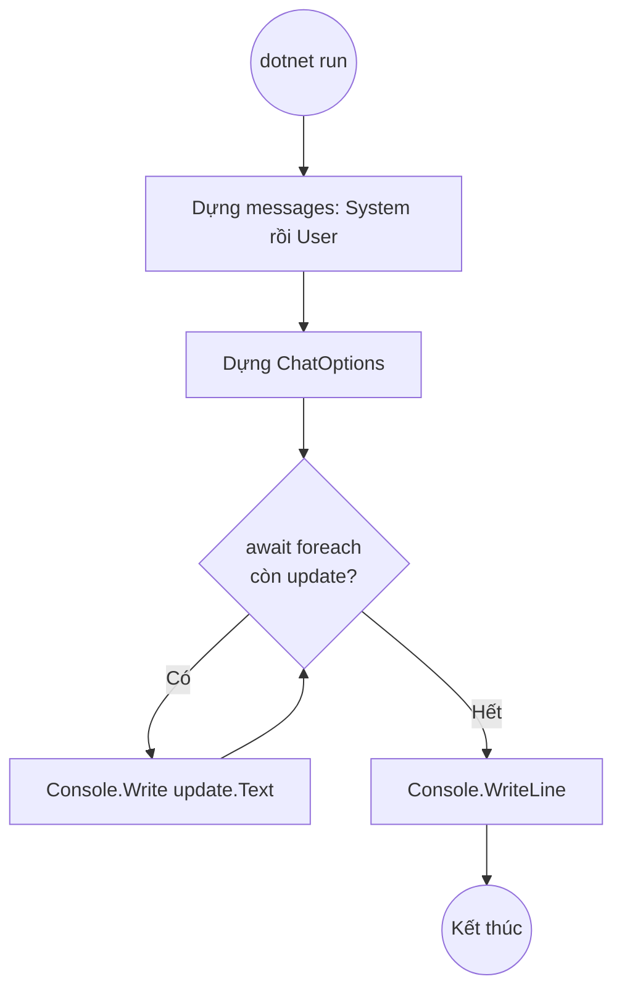
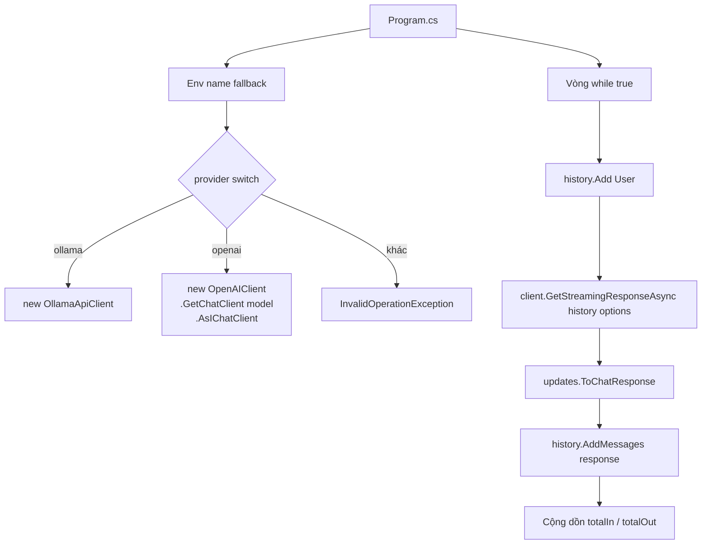
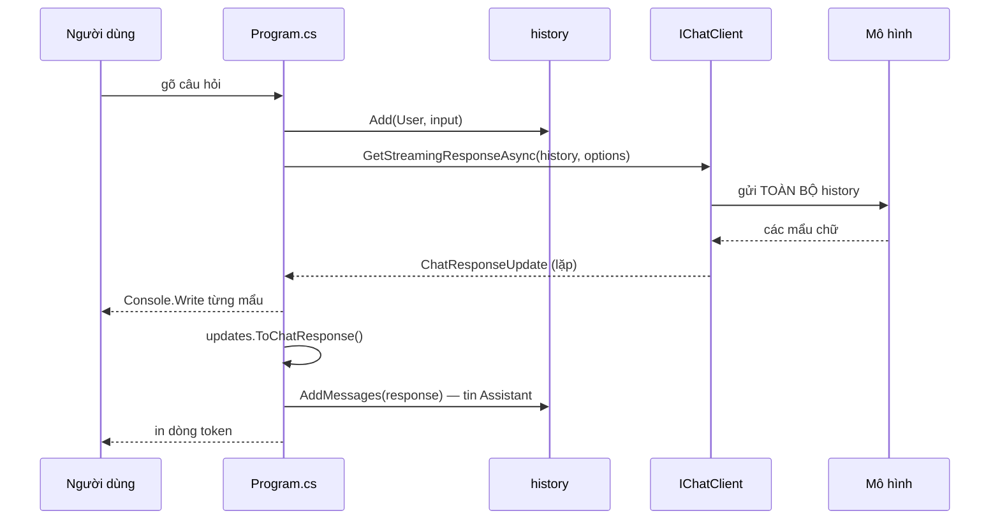
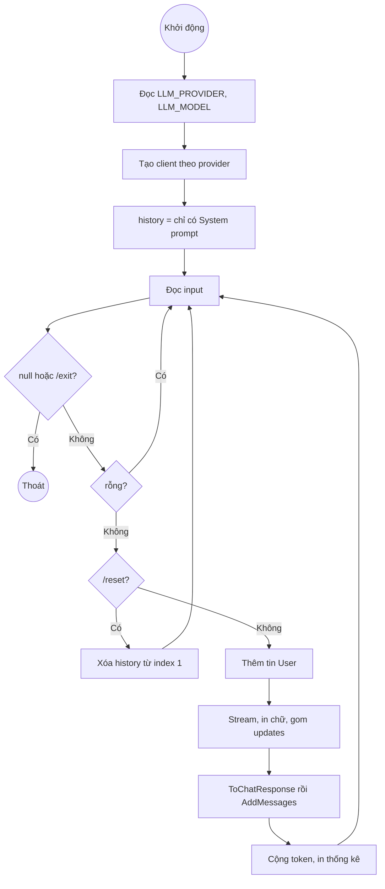
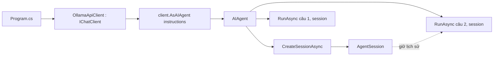
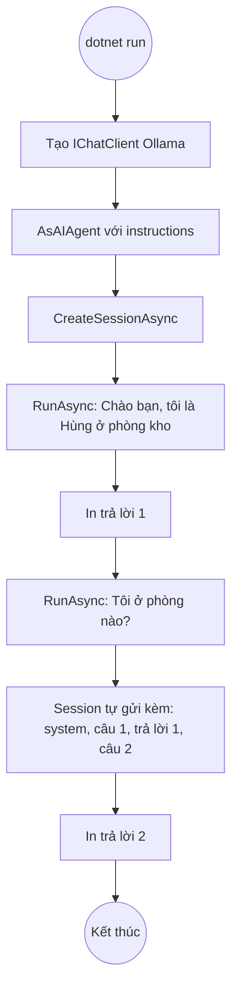

<style>
  @page {
    size: A4;
    margin: 20mm;
    @bottom-right {
      content: "Trang " counter(page) " / " counter(pages);
      font-size: 9pt;
      color: #666;
    }
  }
  .page-break {
    page-break-after: always;
    break-after: page;
  }
  .page-footer {
    display: flex;
    justify-content: space-between;
    font-size: 8.5pt;
    color: #888;
    border-top: 1px solid #e0e0e0;
    padding-top: 4px;
    margin-top: 24px;
  }
</style>

# ErpChat Ngày 1 — Giải thích luồng từng example

Tài liệu giải thích luồng xử lý của 4 project trong `tutorial/ngay-01/` (Ex1–Ex4). Mọi số dòng trích từ `Program.cs` của từng project.

## Mục lục

1. [Tổng quan kiến trúc](#1-tổng-quan-kiến-trúc) (Trang 1)
2. [Ex1: Câu hỏi đầu tiên](#2-ex1-câu-hỏi-đầu-tiên) (Trang 2)
3. [Ex2: System prompt, ChatOptions, streaming](#3-ex2-system-prompt-chatoptions-streaming) (Trang 3)
4. [Ex3: Chatbot nhiều lượt](#4-ex3-chatbot-nhiều-lượt) (Trang 4–5)
5. [Ex4: Bọc thành agent MAF](#5-ex4-bọc-thành-agent-maf) (Trang 6)
6. [Source Mapping và Analogy](#6-source-mapping-và-analogy) (Trang 7)

## 1. Tổng quan kiến trúc

**Vấn đề là gì?** Muốn viết chatbot mà code không dính chặt vào một nhà cung cấp mô hình (Ollama, OpenAI, Azure OpenAI). Microsoft giải bằng interface `IChatClient` (package `Microsoft.Extensions.AI`). Code chat chỉ nói chuyện với interface này. Mỗi nhà cung cấp có một adapter implement nó.

Mô hình **không nhớ gì giữa hai lần gọi**. Muốn nhớ, phải gửi lại toàn bộ lịch sử mỗi lượt. Ex1–Ex3 làm việc này bằng tay. Ex4 giao cho `AgentSession` của MAF.



Tiến hóa qua 4 example:

| Example | Thêm gì so với trước | Ai giữ lịch sử |
|---|---|---|
| Ex1 | Gọi một lần, chờ trọn câu | Không có |
| Ex2 | Danh sách message có vai trò, `ChatOptions`, streaming | Không có (chỉ 1 lượt) |
| Ex3 | Vòng lặp chat, đổi provider, đếm token | Code bạn (`List<ChatMessage>`) |
| Ex4 | Bọc thành `AIAgent` | `AgentSession` (trong bộ nhớ) |

<div class="page-footer"><span>ErpChat Ngày 1 — Giải thích luồng</span><span>Trang 1</span></div>
<div class="page-break"></div>

---

## 2. Ex1: Câu hỏi đầu tiên

**Vấn đề là gì?** Cách ngắn nhất để gửi một câu hỏi tới mô hình và lấy câu trả lời kèm số token đã dùng.

### CallGraph



### Flowchart



### Code snippet

```csharp
// tutorial/ngay-01/Ex1/Program.cs:7
IChatClient client = new OllamaApiClient(new Uri("http://localhost:11434"), "llama3.2");

// tutorial/ngay-01/Ex1/Program.cs:10
ChatResponse response = await client.GetResponseAsync("Giải thích ERP là gì trong 2 câu.");

// tutorial/ngay-01/Ex1/Program.cs:13-14
Console.WriteLine(response.Text);
Console.WriteLine($"Token vào: {response.Usage?.InputTokenCount}, token ra: {response.Usage?.OutputTokenCount}");
```

Điểm cần chú ý:
- Dòng 7: `OllamaApiClient` tự implement `IChatClient`, gán thẳng, không cần bọc.
- Dòng 10: truyền một chuỗi, thư viện tự tạo một message `User`. Không có system prompt, không có lịch sử.
- Dòng 14: `Usage` có thể `null` (một số provider không trả), nên dùng `?.`.

### Input, Transform, Output

| Input | Transform | Output |
|---|---|---|
| `"Giải thích ERP là gì trong 2 câu."` | Thư viện bọc thành `[User: ...]`, gửi HTTP tới Ollama, chờ hết | `response.Text` + số token vào/ra |

Hệ quả: gọi lần hai với "Tôi vừa hỏi gì?" mô hình sẽ không biết, vì mỗi lần gọi độc lập.

<div class="page-footer"><span>ErpChat Ngày 1 — Giải thích luồng</span><span>Trang 2</span></div>
<div class="page-break"></div>

---

## 3. Ex2: System prompt, ChatOptions, streaming

**Vấn đề là gì?** Ex1 không đặt được vai trò cho mô hình, không chỉnh được tham số, và người dùng phải chờ cả câu mới thấy chữ. Ex2 giải cả ba.

### CallGraph



### Flowchart



### Code snippet

```csharp
// tutorial/ngay-01/Ex2/Program.cs:8-12
List<ChatMessage> messages =
[
    new(ChatRole.System, "Bạn là trợ lý ERP. Trả lời ngắn gọn, bằng tiếng Việt."),
    new(ChatRole.User, "Phiếu nhập kho và phiếu xuất kho khác nhau thế nào?")
];

// tutorial/ngay-01/Ex2/Program.cs:14
var options = new ChatOptions { Temperature = 0.2f, MaxOutputTokens = 300 };

// tutorial/ngay-01/Ex2/Program.cs:17-20
await foreach (ChatResponseUpdate update in client.GetStreamingResponseAsync(messages, options))
{
    Console.Write(update.Text);
}
```

### Bảng tham số

| Tham số | Giá trị | Tác dụng |
|---|---|---|
| `ChatRole.System` | prompt dòng 10 | Đặt vai trò và luật. Trong MAF tương đương `instructions`. |
| `Temperature` | 0.2 | Thấp, câu trả lời ổn định, hợp tra cứu ERP. |
| `MaxOutputTokens` | 300 | Chặn câu quá dài và chặn chi phí. Có thể cắt câu giữa chừng. |

`GetStreamingResponseAsync` trả `IAsyncEnumerable<ChatResponseUpdate>`. Mỗi update là một mẩu chữ, in ngay khi tới, nên người dùng thấy chữ sau vài trăm mili giây.

<div class="page-footer"><span>ErpChat Ngày 1 — Giải thích luồng</span><span>Trang 3</span></div>
<div class="page-break"></div>

---

## 4. Ex3: Chatbot nhiều lượt

**Vấn đề là gì?** Ex2 chỉ có một lượt. Chatbot thật cần nhớ câu trước, chọn được provider mà không sửa code, và theo dõi token.

### CallGraph



### Sequence một lượt chat



### Flowchart vòng lặp



### Code snippet 1: chọn provider

```csharp
// tutorial/ngay-01/Ex3/Program.cs:11-12
string provider = Env("LLM_PROVIDER", "ollama");
string model    = Env("LLM_MODEL", "llama3.2");

// tutorial/ngay-01/Ex3/Program.cs:14-27
IChatClient client = provider switch
{
    "ollama" => new OllamaApiClient(new Uri(Env("OLLAMA_ENDPOINT", "http://localhost:11434")), model),
    "openai" => new OpenAIClient(
                    new ApiKeyCredential(Env("OPENAI_API_KEY", "ollama")),
                    new OpenAIClientOptions { Endpoint = new Uri(Env("OPENAI_ENDPOINT", "http://localhost:11434/v1")) })
                .GetChatClient(model)
                .AsIChatClient(),
    _ => throw new InvalidOperationException($"LLM_PROVIDER không hợp lệ: {provider}")
};
```

Nhánh `openai` mặc định trỏ vào cổng tương thích OpenAI của chính Ollama (`/v1`), nên thử được mà không tốn tiền. API key mặc định `"ollama"` chỉ là chuỗi giữ chỗ.

### Code snippet 2: lịch sử và vòng lặp

```csharp
// tutorial/ngay-01/Ex3/Program.cs:30-38
List<ChatMessage> history =
[
    new(ChatRole.System, """ ...không được bịa số... """)
];

// tutorial/ngay-01/Ex3/Program.cs:50
if (input == "/reset") { history.RemoveRange(1, history.Count - 1); Console.WriteLine("(đã xoá lịch sử)"); continue; }

// tutorial/ngay-01/Ex3/Program.cs:52
history.Add(new ChatMessage(ChatRole.User, input));

// tutorial/ngay-01/Ex3/Program.cs:55-60
List<ChatResponseUpdate> updates = [];
await foreach (var update in client.GetStreamingResponseAsync(history, options))
{
    Console.Write(update.Text);
    updates.Add(update);
}

// tutorial/ngay-01/Ex3/Program.cs:64-65
ChatResponse response = updates.ToChatResponse();
history.AddMessages(response);

// tutorial/ngay-01/Ex3/Program.cs:67-68
totalIn  += response.Usage?.InputTokenCount ?? 0;
totalOut += response.Usage?.OutputTokenCount ?? 0;
```

### Ba dòng quyết định (dòng 52, 56, 64-65)

| Dòng | Làm gì | Bỏ đi thì sao |
|---|---|---|
| 52 `history.Add(User)` | Thêm câu hỏi mới | Mô hình không thấy câu hỏi |
| 56 `GetStreamingResponseAsync(history)` | Gửi cả lịch sử, không chỉ câu mới | Mô hình mất ngữ cảnh |
| 64-65 `ToChatResponse` + `AddMessages` | Ghép các mẩu stream thành tin Assistant, cất vào lịch sử | Bot quên câu trả lời của chính nó, lượt sau như hội thoại một chiều |

### Ví dụ lịch sử qua 2 lượt

| Lượt | `history` gửi đi | Token vào |
|---|---|---|
| 1 | System, User1 | nhỏ |
| 2 | System, User1, Assistant1, User2 | lớn hơn |
| 3 | System, User1, Assistant1, User2, Assistant2, User3 | lớn hơn nữa |

Token vào tăng dần vì lịch sử dài ra, và chi phí tăng theo. Đây là lý do chatbot thật phải cắt hoặc tóm tắt lịch sử. Ex3 chưa làm.

<div class="page-footer"><span>ErpChat Ngày 1 — Giải thích luồng</span><span>Trang 4–5</span></div>
<div class="page-break"></div>

---

## 5. Ex4: Bọc thành agent MAF

**Vấn đề là gì?** Ex3 bắt bạn tự quản lý `List<ChatMessage>` và system prompt. MAF đóng gói việc đó vào `AIAgent` và `AgentSession`. Ex4 cho thấy MAF bọc đúng `IChatClient` bạn đã dùng.

### CallGraph



### Flowchart



### Code snippet

```csharp
// tutorial/ngay-01/Ex4/Program.cs:7
IChatClient client = new OllamaApiClient(new Uri("http://localhost:11434"), "llama3.2");

// tutorial/ngay-01/Ex4/Program.cs:10
AIAgent agent = client.AsAIAgent(instructions: "Bạn là trợ lý ERP. Trả lời ngắn, bằng tiếng Việt.");

// tutorial/ngay-01/Ex4/Program.cs:12-14
AgentSession session = await agent.CreateSessionAsync();
Console.WriteLine(await agent.RunAsync("Chào bạn, tôi là Hùng ở phòng kho.", session));
Console.WriteLine(await agent.RunAsync("Tôi ở phòng nào?", session)); // session tự giữ lịch sử
```

### Đối chiếu Ex3 và Ex4

| Việc | Ex3 (tay) | Ex4 (MAF) |
|---|---|---|
| Vai trò | tin `ChatRole.System` đầu `history` | tham số `instructions` |
| Lịch sử | `List<ChatMessage>` + `Add` + `AddMessages` | `AgentSession`, tự giữ |
| Gọi mô hình | `GetStreamingResponseAsync(history)` | `agent.RunAsync(text, session)` |
| Lưu lịch sử ra ngoài (DB) | tự viết | `ChatHistoryProvider` (chưa dùng ở Ex4) |

Project Ex4 thêm package `Microsoft.Agents.AI` 1.24.0 (xem `Ex4.csproj:11`). Ex1–Ex3 không có package này.

<div class="page-footer"><span>ErpChat Ngày 1 — Giải thích luồng</span><span>Trang 6</span></div>
<div class="page-break"></div>

---

## 6. Source Mapping và Analogy

### Source Mapping

| File | Layer | Vai trò kỹ thuật |
|---|---|---|
| `Ex1/Program.cs` | Ứng dụng | Gọi một lần `GetResponseAsync`, in text + usage |
| `Ex2/Program.cs` | Ứng dụng | Message có vai trò, `ChatOptions`, streaming |
| `Ex3/Program.cs` | Ứng dụng | Vòng chat, chọn provider qua env, quản lý lịch sử, đếm token |
| `Ex4/Program.cs` | Ứng dụng | `AsAIAgent`, `AgentSession`, `RunAsync` |
| `Ex1–Ex4/*.csproj` | Build | net10.0, `Microsoft.Extensions.AI` 10.10.0, `.OpenAI` 10.10.1, `OllamaSharp` 5.5.0, `OpenAI` 2.14.0; Ex4 thêm `Microsoft.Agents.AI` 1.24.0 |
| `Microsoft.Extensions.AI` (NuGet) | Abstraction | Interface `IChatClient`, `ChatMessage`, `ChatOptions`, `ChatResponse` |
| `OllamaSharp` (NuGet) | Adapter | `OllamaApiClient` implement `IChatClient` cho Ollama |
| `Microsoft.Extensions.AI.OpenAI` (NuGet) | Adapter | `.AsIChatClient()` biến `ChatClient` của OpenAI thành `IChatClient` |
| `Microsoft.Agents.AI` (NuGet) | Agent | `AIAgent`, `AgentSession`, `AsAIAgent` |
| `Ngay-01-IChatClient-va-chatbot-console.pdf` | Tài liệu | Bài giảng gốc, 11 trang |

### Analogy

`IChatClient` giống **ổ cắm điện chuẩn**. Máy của bạn (code chat) chỉ cần phích cắm đúng chuẩn. Phía sau ổ có thể là điện lưới Ollama hay điện OpenAI; adapter (`OllamaApiClient`, `AsIChatClient`) là bộ chuyển đổi.

Mô hình giống **nhân viên mất trí nhớ sau mỗi cuộc gọi**. Ex3 là bạn tự đưa cho họ cuốn sổ ghi toàn bộ cuộc trò chuyện trước mỗi lần hỏi (`history`). Ex4 là thuê một **thư ký** (`AgentSession`) làm việc cầm sổ giúp. Sổ càng dày thì đọc càng lâu và tốn tiền (token vào tăng dần).

### Lưu ý khi chạy

- Cần Ollama chạy ở `localhost:11434` và đã `ollama pull llama3.2`.
- Theo PDF, code mới được kiểm với server Ollama giả lập, chưa chạy với mô hình thật.
- Ex3 chưa có xử lý lỗi kết nối và chưa giới hạn độ dài lịch sử.

<div class="page-footer"><span>ErpChat Ngày 1 — Giải thích luồng</span><span>Trang 7</span></div>
