<style>
  @page {
    size: A4;
    margin: 20mm;
    @bottom-right {
      content: "Trang " counter(page) " / " counter(pages);
      font-size: 9pt;
      color: #666;
    }
  }
  .page-break {
    page-break-after: always;
    break-after: page;
  }
  .page-footer {
    display: flex;
    justify-content: space-between;
    font-size: 8.5pt;
    color: #888;
    border-top: 1px solid #e0e0e0;
    padding-top: 4px;
    margin-top: 24px;
  }
</style>

# Ngày 2 — Function calling: giải thích 4 bài mẫu Ex1–Ex4

> Phạm vi: `tutorial/ngay-02/` gồm `Ngay-02-Function-calling.pdf` (10 trang) và 4 project `Ex1`–`Ex4`. Mọi đường dẫn bên dưới tính từ thư mục `tutorial/ngay-02/`.
> Nguồn đối chiếu: đã đọc toàn bộ 4 file `Program.cs`, 4 file `.csproj` và cả 10 trang PDF.
> **Chưa kiểm tra:** chưa build, chưa chạy 4 bài với Ollama thật; các kết quả chạy trích ở dưới là lấy từ PDF (tác giả PDF ghi chạy trên server Ollama giả, chứ không phải mô hình thật).

## Mục lục

1. [Tổng quan: mô hình chỉ "xin", code mới chạy](#1-tổng-quan-mô-hình-chỉ-xin-code-mới-chạy) (Trang 1)
2. [Biến hàm C# thành tool (`AIFunctionFactory`)](#2-biến-hàm-c-thành-tool-aifunctionfactory) (Trang 2)
3. [Flow 1 (Ex1): tự tay chạy vòng lặp](#3-flow-1-ex1-tự-tay-chạy-vòng-lặp) (Trang 3)
4. [Flow 2 (Ex2): `UseFunctionInvocation` chạy thay](#4-flow-2-ex2-usefunctioninvocation-chạy-thay) (Trang 4)
5. [Flow 3 (Ex3): nhiều tool, streaming, giới hạn và log](#5-flow-3-ex3-nhiều-tool-streaming-giới-hạn-và-log) (Trang 5)
6. [Flow 4 (Ex4): agent MAF và duyệt trước khi ghi](#6-flow-4-ex4-agent-maf-và-duyệt-trước-khi-ghi) (Trang 6)
7. [Lỗi thường gặp, nguyên tắc an toàn, bài tập](#7-lỗi-thường-gặp-nguyên-tắc-an-toàn-bài-tập) (Trang 7)
8. [Điểm lệch, Source Mapping, Analogy](#8-điểm-lệch-source-mapping-analogy) (Trang 8)

---

## 1. Tổng quan: mô hình chỉ "xin", code mới chạy

### Vấn đề là gì?

Ngày 1, chatbot ERP chỉ trò chuyện và phải trả lời "tôi chưa có dữ liệu". Ngày 2 cần chatbot trả lời "Mã SP-001 còn bao nhiêu?" bằng **số thật lấy từ một hàm C#**. Nhưng mô hình ngôn ngữ không chạy được code của bạn. Nó chỉ sinh văn bản. Function calling là giao ước: mô hình sinh ra một "đơn xin gọi hàm" (tên hàm + tham số JSON), code C# chạy hàm, gửi kết quả lại, rồi mô hình viết câu trả lời cuối.

Bốn bài mẫu đi từ thủ công đến tự động:

| Bài | Mục đích | Ai chạy vòng lặp? | Có gì mới |
|---|---|---|---|
| Ex1 | Thấy tận mắt cơ chế xin/chạy | Code của bạn (`foreach`) | `FunctionCallContent`, `FunctionResultContent`, `CallId` |
| Ex2 | Giao vòng lặp cho thư viện | `FunctionInvokingChatClient` | `UseFunctionInvocation()`, `response.Messages`, `Usage` |
| Ex3 | Gần chatbot thật | Middleware, có cấu hình | 3 tool, streaming, `FunctionInvoker`, giới hạn vòng lặp |
| Ex4 | Dùng agent MAF, tool ghi phải duyệt | `ChatClientAgent` | `AsAIAgent(tools:)`, `ApprovalRequiredAIFunction` |

### CallGraph: các thành phần chung của cả 4 bài

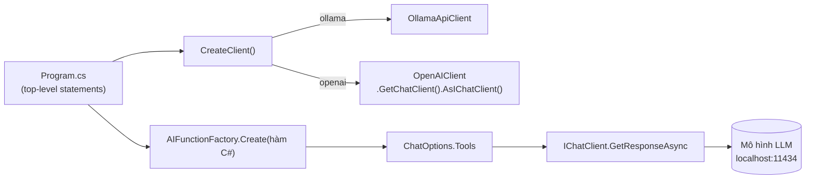

### Flowchart: một câu hỏi cần tool

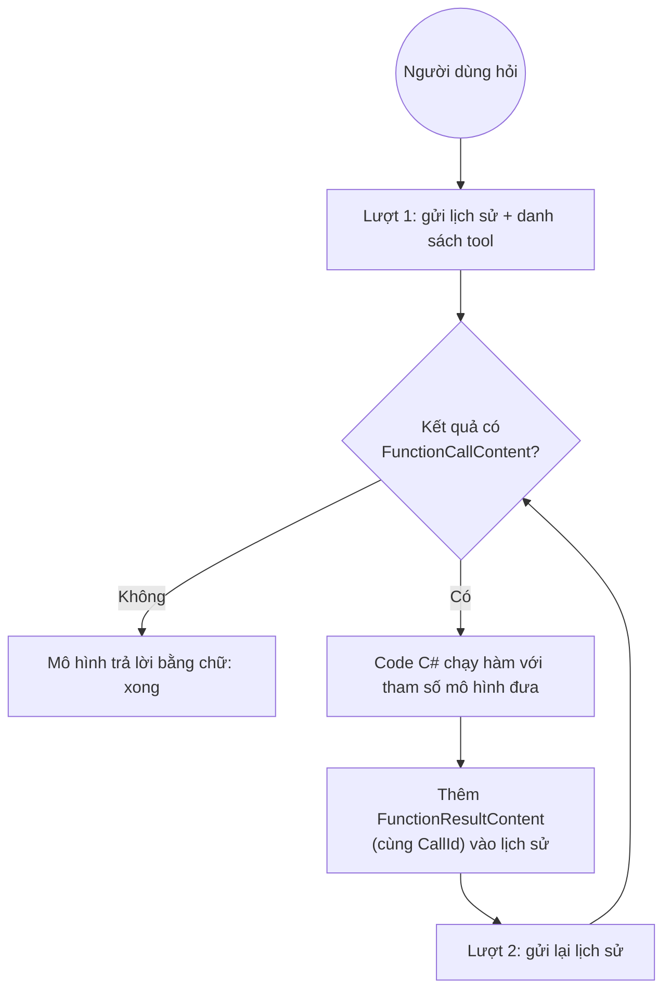

### Code snippet thật: chọn provider (giống nhau ở cả 4 bài)

```csharp
// Ex1/Program.cs:66-79 (Ex2:66-79, Ex3:85-98, Ex4:75-88 y hệt)
static IChatClient CreateClient()
{
    string provider = Env("LLM_PROVIDER", "ollama");
    string model = Env("LLM_MODEL", "llama3.2");
    return provider switch
    {
        "ollama" => new OllamaApiClient(new Uri(Env("OLLAMA_ENDPOINT", "http://localhost:11434")), model),
        "openai" => new OpenAIClient(
                        new ApiKeyCredential(Env("OPENAI_API_KEY", "ollama")),
                        new OpenAIClientOptions { Endpoint = new Uri(Env("OPENAI_ENDPOINT", "http://localhost:11434/v1")) })
                    .GetChatClient(model).AsIChatClient(),
        _ => throw new InvalidOperationException($"LLM_PROVIDER không hợp lệ: {provider}")
    };
}
```

Cả hai nhánh cùng trả `IChatClient`, nên phần còn lại của bài không phụ thuộc provider. Nhánh `openai` trỏ vào `/v1` của chính Ollama (API tương thích OpenAI), nên không cần khóa thật.

### Bảng 5 loại tin nhắn trong lịch sử (PDF trang 2)

| `ChatRole` | `AIContent` | Ai tạo ra |
|---|---|---|
| `system` | `TextContent`: hướng dẫn | Bạn |
| `user` | `TextContent`: câu hỏi | Người dùng |
| `assistant` | `FunctionCallContent`: tên hàm, tham số, `CallId` | Mô hình |
| `tool` | `FunctionResultContent`: kết quả, cùng `CallId` | Code của bạn |
| `assistant` | `TextContent`: câu trả lời cuối | Mô hình |

**Analogy:** nhân viên mới (mô hình) không có chìa khóa kho. Họ viết phiếu "đề nghị xem tồn kho SP-001" (`FunctionCallContent`). Thủ kho (code C#) đi kiểm, ghi kết quả lên phiếu có cùng số phiếu (`CallId`), rồi đưa lại. Nhân viên mới đọc phiếu và báo lại khách.

<div class="page-footer"><span>Ngày 2 — Function calling: Ex1–Ex4</span><span>Trang 1</span></div>
<div class="page-break"></div>

---

## 2. Biến hàm C# thành tool (`AIFunctionFactory`)

### Vấn đề là gì?

Mô hình chỉ biết có hàm nào nhờ danh sách `ChatOptions.Tools` gửi kèm **mỗi request**: mỗi tool là một tên, một mô tả và một JSON schema tham số. Viết tay schema dễ sai. `AIFunctionFactory.Create` đọc chữ ký hàm và thuộc tính `[Description]` rồi sinh ra `AIFunction`.

### CallGraph

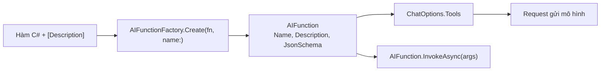

### Flowchart: mô hình chọn tool

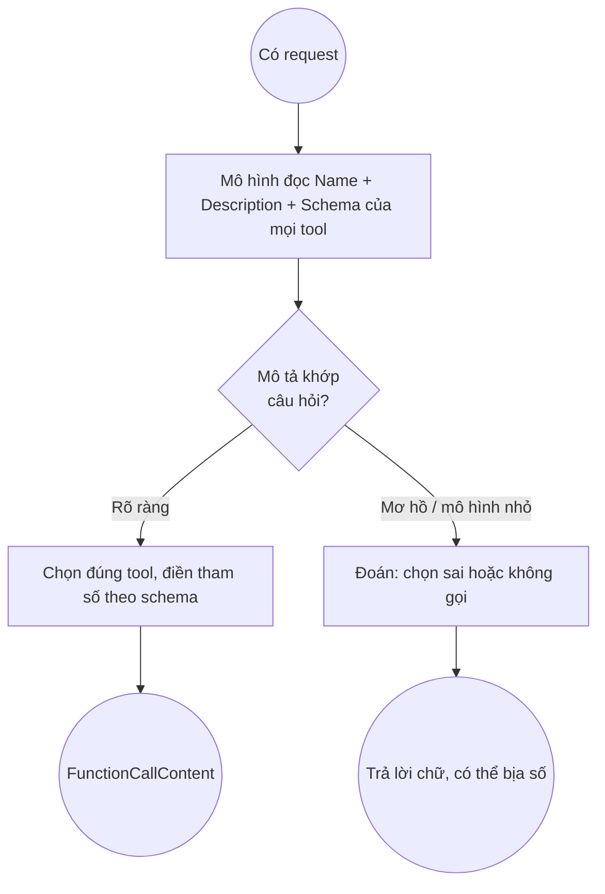

### Code snippet thật

```csharp
// Ex1/Program.cs:54-64 (hàm) và :16 (tạo tool)
[Description("Tra số lượng tồn kho hiện tại của một mã sản phẩm trong ERP.")]
static StockInfo GetStock([Description("Mã sản phẩm, ví dụ SP-001")] string productCode)
{
    Console.WriteLine($"     (C# đang chạy GetStock(\"{productCode}\"))");
    return productCode.ToUpperInvariant() switch
    {
        "SP-001" => new("SP-001", "Bàn phím cơ K87", 124, "cái", "Kho Hà Nội"),
        "SP-002" => new("SP-002", "Chuột không dây M3", 8, "cái", "Kho Hà Nội"),
        _ => new(productCode, "(không tìm thấy)", 0, "", "")
    };
}

AIFunction getStock = AIFunctionFactory.Create(GetStock, name: "get_stock");
```

Schema mô hình nhận (in ra ở `Ex1/Program.cs:17`, trích từ PDF trang 3):

```json
{"type":"object","properties":{"productCode":{"description":"Mã sản phẩm, ví dụ SP-001","type":"string"}},"required":["productCode"]}
```

### Bảng Input → Transform → Output

| Input trong code | Transform | Output mô hình thấy |
|---|---|---|
| tên hàm `GetStock`, truyền `name: "get_stock"` | đặt tên tường minh | `Name = "get_stock"` |
| `[Description]` trên hàm | copy nguyên | `Description` của tool |
| `[Description]` trên tham số `productCode` | vào `properties.productCode.description` | mô tả tham số |
| kiểu `string` không nullable | thêm vào `required` | `"required":["productCode"]` |
| giá trị trả về `record StockInfo` | serialize JSON khi gửi lại | nội dung `FunctionResultContent.Result` |

### Ba điều cần nhớ (PDF trang 3)

1. **Luôn đặt `name:` tường minh.** Hàm local trong top-level statements bị trình biên dịch đổi tên (kiểu `_Main_g_GetStock_0_1`, ghi ở comment `Ex1/Program.cs:15`). Mô hình vẫn gọi được nhưng tên vô nghĩa dễ làm nó chọn sai khi có nhiều tool.
2. **Mô tả là prompt.** Viết như giải thích cho đồng nghiệp mới; với hàm ghi dữ liệu, nói rõ "đây là thao tác GHI" (xem `Ex4/Program.cs:65`).
3. **Kiểu trả về tự do** (record, kiểu ẩn danh, mảng đều được), nhưng mọi byte kết quả đều tính token: chỉ trả các cột cần. `CancellationToken` được truyền tự động và không lộ ra cho mô hình.

**Analogy:** `[Description]` giống nhãn dán trên ngăn kéo. Ngăn nhãn "Hàm 1" hay "x" thì người lạ mở nhầm. Ngăn nhãn "Tồn kho theo mã SP-xxx" thì mở đúng.

<div class="page-footer"><span>Ngày 2 — Function calling: Ex1–Ex4</span><span>Trang 2</span></div>
<div class="page-break"></div>

---

## 3. Flow 1 (Ex1): tự tay chạy vòng lặp

### Vấn đề là gì?

Trước khi dùng middleware, cần thấy cơ chế thật. Ex1 dùng client "trần" (không có `UseFunctionInvocation`), nên mô hình trả về `FunctionCallContent` và **không có ai chạy hàm giùm**. Code phải tự làm 5 việc: gửi, đọc đơn xin, chạy hàm, gửi kết quả, gọi lượt 2.

### CallGraph

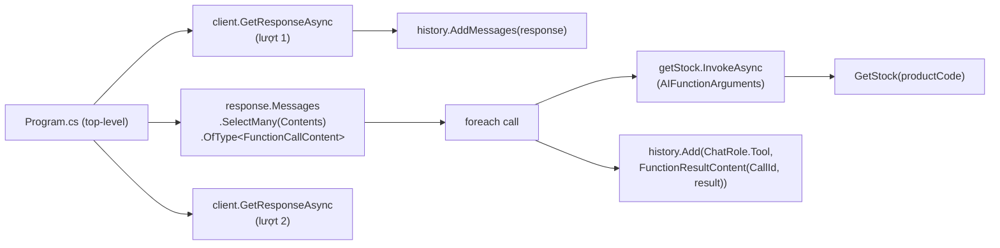

### Flowchart

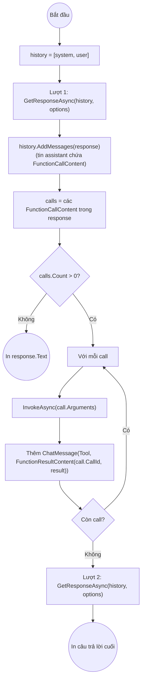

### Code snippet thật

```csharp
// Ex1/Program.cs:27-32 — lượt 1 và lấy đơn xin
ChatResponse response = await client.GetResponseAsync(history, options);
history.AddMessages(response);

var calls = response.Messages.SelectMany(m => m.Contents).OfType<FunctionCallContent>().ToList();
Console.WriteLine($"Lượt 1: mô hình xin gọi {calls.Count} hàm, FinishReason = {response.FinishReason}");
```

```csharp
// Ex1/Program.cs:34-46 — code của bạn chạy hàm, rồi lượt 2
foreach (FunctionCallContent call in calls)
{
    object? result = await getStock.InvokeAsync(new AIFunctionArguments(call.Arguments));
    history.Add(new ChatMessage(ChatRole.Tool, [new FunctionResultContent(call.CallId, result)]));
}

response = await client.GetResponseAsync(history, options);
history.AddMessages(response);
Console.WriteLine($"\nTrợ lý: {response.Text}\n");
```

Chú ý: `getStock` được hard-code ở dòng 39. Ex1 chỉ có một tool nên không phải tra tên; với nhiều tool, middleware ở Ex2 mới tìm `AIFunction` theo `call.Name`.

### Bảng ví dụ (PDF trang 5–6)

| Bước | Dữ liệu | Ghi chú |
|---|---|---|
| Vào | "Mã SP-001 còn bao nhiêu trong kho?" | `Ex1/Program.cs:23` |
| Lượt 1 ra | `FunctionCallContent get_stock(productCode=SP-001)`, `CallId=01944097` | mô hình xin, chưa có số |
| Chạy hàm | `GetStock("SP-001")` → `StockInfo(..., 124, "cái", "Kho Hà Nội")` | do C# chạy |
| Lượt 2 ra | câu trả lời tiếng Việt dựa trên số 124 | mô hình đọc `FunctionResultContent` |
| Lịch sử cuối | `system, user, assistant(FunctionCall), tool(FunctionResult), assistant(Text)` | 5 tin, 4 loại nội dung |

**Đừng dựa vào `FinishReason`.** PDF trang 6: qua OllamaSharp nó là `stop` dù có tool call, qua OpenAI là `tool_calls`. Kiểm tra bằng sự có mặt của `FunctionCallContent` như dòng 31.

**Analogy:** Ex1 là bạn tự làm cả hai vai: đọc phiếu xin của nhân viên, tự đi kho, tự ghi kết quả lên phiếu, tự đưa lại. Mệt, nhưng hiểu rõ từng bước.

<div class="page-footer"><span>Ngày 2 — Function calling: Ex1–Ex4</span><span>Trang 3</span></div>
<div class="page-break"></div>

---

## 4. Flow 2 (Ex2): `UseFunctionInvocation` chạy thay

### Vấn đề là gì?

Vòng lặp ở Ex1 phải viết lại cho mọi chatbot: tra tool theo tên, xử lý nhiều call cùng lúc, lặp nếu mô hình xin tiếp. `ChatClientBuilder.UseFunctionInvocation()` bọc client trong middleware `FunctionInvokingChatClient` làm hết việc đó. Code gọi vẫn chỉ là **một** `GetResponseAsync`.

### CallGraph

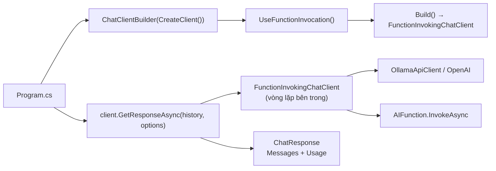

### Flowchart: bên trong một lời gọi

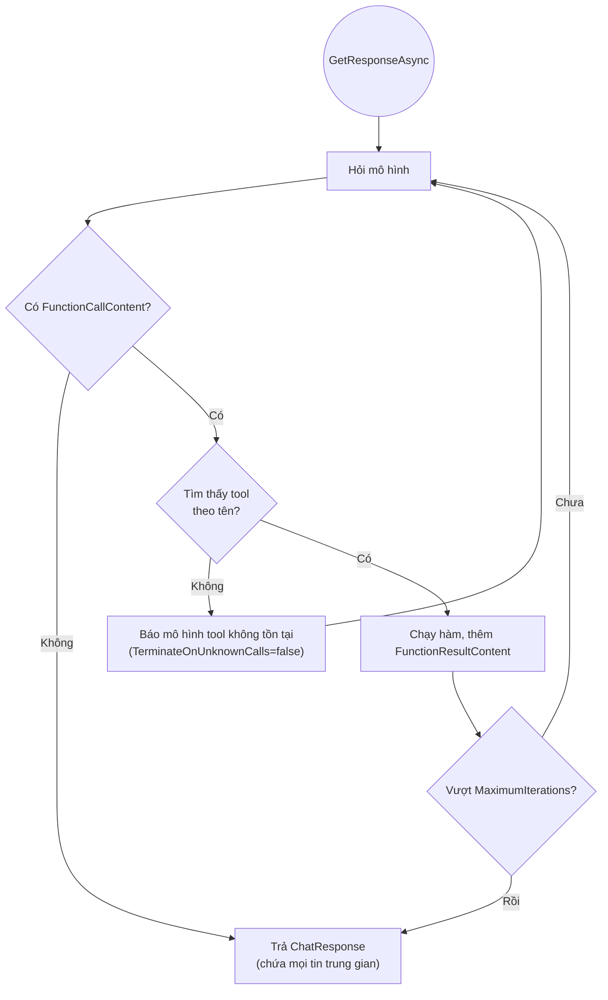

### Code snippet thật

```csharp
// Ex2/Program.cs:12-19 — bọc client và khai báo tool
IChatClient client = new ChatClientBuilder(CreateClient())
    .UseFunctionInvocation()
    .Build();

var options = new ChatOptions
{
    Tools = [AIFunctionFactory.Create(GetStock, name: "get_stock")]
};
```

```csharp
// Ex2/Program.cs:37-54 — MỘT lời gọi, rồi soi các tin trung gian
ChatResponse response = await client.GetResponseAsync(history, options);

foreach (ChatMessage m in response.Messages)
    foreach (AIContent c in m.Contents)
        switch (c)
        {
            case FunctionCallContent call:
                Console.WriteLine($"   [gọi]    {call.Name}({string.Join(", ", call.Arguments!.Select(a => $"{a.Key}={a.Value}"))})");
                break;
            case FunctionResultContent result:
                Console.WriteLine($"   [kết quả] {result.Result?.ToString()?.ReplaceLineEndings(" ")}");
                break;
        }
Console.WriteLine($"   ({response.Messages.Count} tin nhắn trả về, token vào/ra: {response.Usage?.InputTokenCount}/{response.Usage?.OutputTokenCount})");
```

### Bảng 3 câu hỏi và kết quả quan sát (PDF trang 4–6)

| Câu hỏi (`Ex2/Program.cs:23-25`) | Số lần gọi tool | `Messages` trả về | Ghi chú |
|---|---|---|---|
| "Mã SP-001 còn bao nhiêu trong kho?" | 1 | 3 (gọi, kết quả, trả lời) | tổng token ≈ 100/40 |
| "So sánh tồn kho SP-001 và SP-002" | 2 (song song trong cùng một lượt) | 3 theo PDF | mỗi kết quả mang đúng `CallId` của đơn xin tương ứng |
| "Chào bạn, bạn làm được gì?" | 0 | 1 | token ≈ 50/20, nhẹ hơn câu có tool |

Hai điều rút ra:

- `response.Messages` chứa **cả tin trung gian**, không chỉ câu cuối. Muốn lượt sau mô hình còn nhớ số đã tra, thêm cả `response` vào lịch sử bằng `history.AddMessages(response)` thay vì chỉ thêm `response.Text`.
- `response.Usage` là **tổng** các lần gọi mô hình bên trong, nên câu có tool tốn gấp đôi.

Ở Ex2 mỗi câu hỏi tạo `history` mới (`Ex2/Program.cs:30-34`), nên các câu hỏi **không nhớ nhau**. Việc giữ lịch sử qua nhiều lượt chỉ có từ Ex3.

**Analogy:** Ex2 là thuê quản lý. Bạn chỉ nói "tôi cần biết tồn kho", quản lý tự đọc phiếu xin, tự đi kho, tự quay lại hỏi nhân viên, lặp đến khi có câu trả lời rồi mới báo bạn.

<div class="page-footer"><span>Ngày 2 — Function calling: Ex1–Ex4</span><span>Trang 4</span></div>
<div class="page-break"></div>

---

## 5. Flow 3 (Ex3): nhiều tool, streaming, giới hạn và log

### Vấn đề là gì?

Một chatbot thật cần: nhiều tool, trả lời streaming từng chữ, lịch sử nhiều lượt, chặn vòng lặp gọi hàm vô hạn, và **một chỗ duy nhất** để log/đo thời gian/kiểm tra quyền mỗi lần gọi hàm. Ex3 nâng ErpChat ngày 1 lên mức đó.

### CallGraph

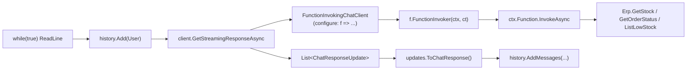

### Flowchart: một lượt chat

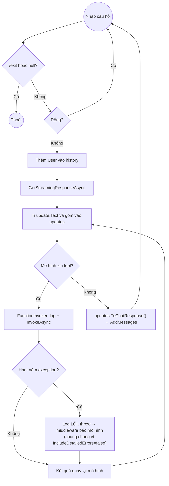

### Code snippet thật

```csharp
// Ex3/Program.cs:13-39 — cấu hình middleware
IChatClient client = new ChatClientBuilder(CreateClient())
    .UseFunctionInvocation(configure: f =>
    {
        f.MaximumIterationsPerRequest = 5;          // mặc định 40
        f.MaximumConsecutiveErrorsPerRequest = 2;   // mặc định 3
        f.IncludeDetailedErrors = false;            // không đưa nội dung exception cho mô hình
        f.AllowConcurrentInvocation = false;        // các hàm chạy lần lượt

        f.FunctionInvoker = async (ctx, ct) =>
        {
            var sw = Stopwatch.StartNew();
            Console.Write($"\n   [tool] {ctx.Function.Name}(...)");
            try
            {
                object? result = await ctx.Function.InvokeAsync(ctx.Arguments, ct);
                Console.WriteLine($" -> ok, {sw.ElapsedMilliseconds} ms (vòng {ctx.Iteration})");
                return result;
            }
            catch (Exception ex)
            {
                Console.WriteLine($" -> LỖI: {ex.Message}");
                throw; // middleware báo lỗi cho mô hình
            }
        };
    })
    .Build();
```

```csharp
// Ex3/Program.cs:70-82 — streaming và giữ đủ ngữ cảnh gọi hàm
history.Add(new ChatMessage(ChatRole.User, input));
Console.Write("Trợ lý: ");
List<ChatResponseUpdate> updates = [];
await foreach (var update in client.GetStreamingResponseAsync(history, options))
{
    Console.Write(update.Text);
    updates.Add(update);
}
Console.WriteLine();

history.AddMessages(updates.ToChatResponse());
```

```csharp
// Ex3/Program.cs:120-127 — tool cố ý ném exception có câu SQL
[Description("Tra số lượng tồn kho hiện tại của một mã sản phẩm.")]
public static object GetStock([Description("Mã sản phẩm, dạng SP-xxx")] string productCode)
{
    string code = productCode.Trim().ToUpperInvariant();
    if (!Stock.TryGetValue(code, out var s))
        throw new KeyNotFoundException($"Không có sản phẩm {code} trong bảng Items (SQL: SELECT ... WHERE Code='{code}')");
    return new { productCode = code, productName = s.Name, quantity = s.Qty, unit = s.Unit };
}
```

### Bảng cấu hình (PDF trang 4) và hai cách báo "không tìm thấy"

| Thuộc tính | Mặc định | Ex3 đặt | Tác dụng |
|---|---|---|---|
| `MaximumIterationsPerRequest` | 40 | 5 | chặn vòng lặp vô hạn |
| `MaximumConsecutiveErrorsPerRequest` | 3 | 2 | số vòng lỗi liên tiếp trước khi ném exception ra ngoài |
| `IncludeDetailedErrors` | false | false | mô hình chỉ thấy "Error: Function failed." |
| `AllowConcurrentInvocation` | false | false | có chạy song song nhiều hàm không |
| `FunctionInvoker` | null | log + đo ms | bọc mọi lần gọi hàm |

| Hàm | Khi không tìm thấy | Mô hình nhận được |
|---|---|---|
| `GetStock` (`Ex3/Program.cs:124-125`) | ném `KeyNotFoundException` | `"Error: Function failed."` (SQL không lộ) |
| `GetOrderStatus` (`:133-135`) | trả object `status = "Không tìm thấy"` | dữ liệu có cấu trúc, mô hình diễn đạt lại |

Chạy thử SP-999 theo PDF trang 7: console người phát triển thấy lỗi đầy đủ (kèm SQL), còn mô hình chỉ nhận `"Error: Function failed."`. Với mô hình nhỏ, câu trả lời có thể trở nên vụng (PDF ghi server giả trả `Theo dữ liệu ERP: {"CallId":...,"Result":"Error: Function failed."}`).

**Analogy:** `FunctionInvoker` là máy quét thẻ ở cổng kho. Mọi lượt ra vào đều bị ghi giờ và tên, và đây cũng là chỗ để từ chối người không có quyền.

<div class="page-footer"><span>Ngày 2 — Function calling: Ex1–Ex4</span><span>Trang 5</span></div>
<div class="page-break"></div>

---

## 6. Flow 4 (Ex4): agent MAF và duyệt trước khi ghi

### Vấn đề là gì?

Tool **đọc** (tra tồn kho) chạy tự do. Tool **ghi** (tạo phiếu đề xuất mua hàng) không được để mô hình tự quyết. Ex4 dùng agent MAF: `ChatClientAgent` tự thêm `FunctionInvokingChatClient` (không cần `UseFunctionInvocation`), còn tool ghi được bọc bằng `ApprovalRequiredAIFunction`, khiến agent **dừng lại** trả `ToolApprovalRequestContent` và chờ người dùng.

### CallGraph

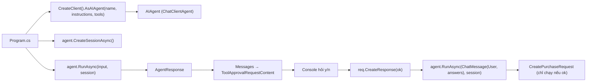

### Flowchart

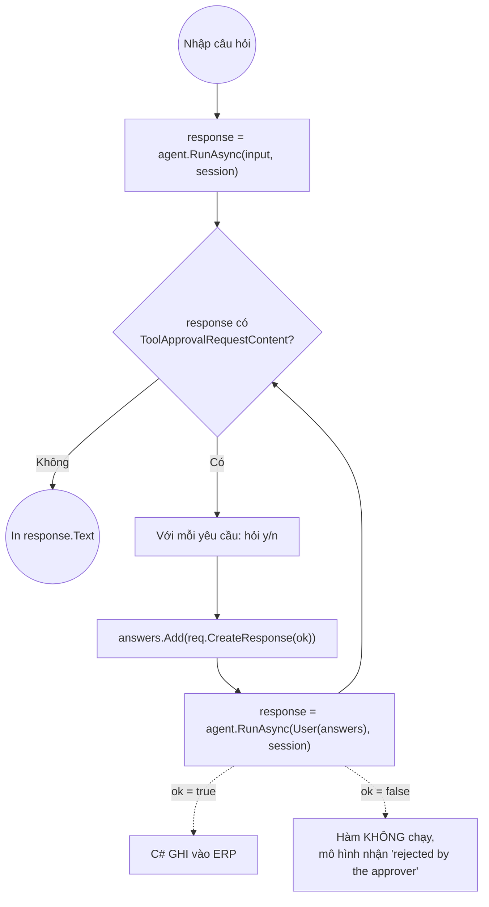

### Code snippet thật

```csharp
// Ex4/Program.cs:13-22 — tool đọc chạy luôn, tool ghi phải duyệt
AIFunction getStock = AIFunctionFactory.Create(GetStock, name: "get_stock");
AIFunction createPr = AIFunctionFactory.Create(CreatePurchaseRequest, name: "create_purchase_request");

AIAgent agent = CreateClient().AsAIAgent(
    name: "TroLyERP",
    instructions: "Bạn là Trợ lý ERP. Trả lời tiếng Việt, ngắn gọn. Dùng tool để lấy số liệu và tạo đề xuất mua hàng.",
    tools: [getStock, new ApprovalRequiredAIFunction(createPr)]); // đọc: chạy luôn | ghi: phải duyệt

AgentSession session = await agent.CreateSessionAsync();
```

```csharp
// Ex4/Program.cs:32-49 — vòng duyệt
AgentResponse response = await agent.RunAsync(input, session);

List<ToolApprovalRequestContent> requests;
while ((requests = response.Messages.SelectMany(m => m.Contents).OfType<ToolApprovalRequestContent>().ToList()).Count > 0)
{
    List<AIContent> answers = [];
    foreach (ToolApprovalRequestContent req in requests)
    {
        var call = (FunctionCallContent)req.ToolCall;
        Console.Write($"   [cần duyệt] {call.Name}(...). Đồng ý? (y/n): ");
        bool ok = Console.ReadLine()?.Trim().ToLowerInvariant() == "y";
        answers.Add(req.CreateResponse(ok));
    }
    response = await agent.RunAsync(new ChatMessage(ChatRole.User, answers), session);
}
```

### Bảng kết quả chạy (PDF trang 7)

| Lượt | Người dùng | Agent | Hàm C# có chạy? |
|---|---|---|---|
| 1 | "Tạo đề xuất đặt mua 20 cái SP-003" | `[cần duyệt] create_purchase_request(productCode=SP-003, quantity=20)` | chưa |
| 1 | gõ `y` | `(C# GHI vào ERP: PR-6307 = 20 x SP-003)` | **có** |
| 2 | "Tạo đề xuất đặt mua 5 cái SP-003" | `[cần duyệt] ...(quantity=5)` | chưa |
| 2 | gõ `n` | "Tool call invocation was rejected by the approver and must not be retried." | **không** |

Ba điểm cần lưu ý khi đọc code:

- Lịch sử nằm trong `AgentSession`, không còn là `List<ChatMessage>` do bạn tự giữ như Ex3. Câu trả lời duyệt phải gửi vào **cùng `session`** (dòng 48) để agent biết đang duyệt yêu cầu nào.
- Dòng 43 chạy `Trim().ToLowerInvariant()` rồi so với `"y"`, nên `y`, `Y`, ` y ` đều là đồng ý. Mọi đầu vào khác (Enter, `yes`, `có`) bị coi là **từ chối**. Mặc định an toàn: không rõ thì không ghi.
- `ToolApprovalRequestContent` có mặt trong `Microsoft.Agents.AI` 1.25.0 mà không cần tắt cảnh báo experimental (PDF trang 7).

**Analogy:** `ApprovalRequiredAIFunction` như tờ phiếu chi cần chữ ký trưởng phòng. Nhân viên (mô hình) soạn phiếu xong thì kế toán (C#) **không chi** cho đến khi có chữ ký (`y`). Không ký thì phiếu bị trả về kèm lý do.

<div class="page-footer"><span>Ngày 2 — Function calling: Ex1–Ex4</span><span>Trang 6</span></div>
<div class="page-break"></div>

---

## 7. Lỗi thường gặp, nguyên tắc an toàn, bài tập

### Vấn đề là gì?

Tool là cửa để mô hình chạm vào dữ liệu thật, nên thiết kế tool quan trọng ngang thiết kế API. Dưới đây gom lại bảng lỗi và nguyên tắc từ PDF trang 8–9, kèm vị trí trong code minh họa cho từng điều.

### Bảng triệu chứng, nguyên nhân, cách xử lý

| Triệu chứng | Nguyên nhân hay gặp | Cách xử lý | Chỗ trong code |
|---|---|---|---|
| Mô hình trả lời luôn, không gọi tool | mô hình nhỏ gọi tool kém, hoặc mô tả mơ hồ | thử `qwen2.5:7b`, viết lại mô tả, nói rõ "luôn dùng tool" trong system prompt | `Ex3/Program.cs:56-58` |
| Mô hình bịa số | system prompt không cấm | giữ câu "không bao giờ tự bịa số" | có ở Ex1/2/3, **thiếu ở Ex4** |
| Tool tên `_Main_g_...` | hàm local trong top-level statements | truyền `name:` | mọi `AIFunctionFactory.Create` |
| Lượt sau mô hình quên số vừa tra | chỉ thêm câu trả lời cuối | `history.AddMessages(response)` | `Ex1:45`, `Ex3:81` |
| Token tăng nhanh | tool trả quá nhiều cột/dòng | chỉ trả cột cần, giới hạn dòng | `Ex3:141` (chỉ 3 cột) |
| Lộ SQL / stack trace | `IncludeDetailedErrors = true` | giữ `false`, log phía server | `Ex3:18` |

### Flowchart: kiểm tra một tool trước khi cho mô hình dùng

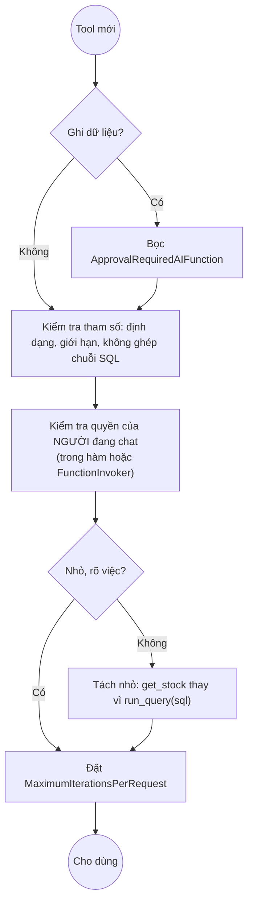

### Năm nguyên tắc (PDF trang 8)

1. **Tham số do mô hình sinh ra là đầu vào không tin cậy.** Kiểm tra định dạng (`SP-xxx`), giới hạn số lượng, không ghép chuỗi thành SQL.
2. **Quyền của tool = quyền của người đang chat**, không phải quyền của service. Kiểm tra trong hàm hoặc trong `FunctionInvoker`.
3. **Tách tool đọc và tool ghi.** Tool ghi luôn bọc `ApprovalRequiredAIFunction`.
4. **Tool nhỏ, rõ việc.** `get_stock(productCode)` tốt hơn `run_query(sql)`; tool "chạy SQL bất kỳ" mở cửa cho prompt injection.
5. **Giới hạn vòng lặp** bằng `MaximumIterationsPerRequest`.

### Bài tập (PDF trang 9)

| Bài | Làm trên | Nội dung | Gợi ý điểm chạm |
|---|---|---|---|
| 1 | Ex3 | tool `get_customer_debt(customerCode)`, dữ liệu giả 2–3 khách | thêm hàm vào `Erp` và vào `Tools` (`Ex3:46-48`) |
| 2 | Ex3 | đổi mô tả `get_stock` thành "Hàm 1", tham số thành "x", hỏi lại 5 câu, đếm lần gọi đúng | thấy rõ mô tả là prompt |
| 3 | Ex3 | từ chối mã không khớp `^SP-\d{3}$` bằng object lỗi (không ném exception), so sánh hai cách | `Ex3:124` |
| 4 | Ex3 | `string currentUserRole = "sales"`; trong `FunctionInvoker` chặn `get_customer_debt` với vai trò `sales` | `Ex3:22-37` |
| 5 | Ex4 | chỉ hỏi duyệt khi `quantity > 50`, dưới đó tự đồng ý (đọc `call.Arguments["quantity"]`) | `Ex4:41-45` |
| 6 | nâng cao | thay dữ liệu giả bằng `HttpClient` tới endpoint ERP test; hàm thành `async Task<object>` nhận `CancellationToken` | `Ex3:120-127` |

Xong ngày 2 khi: chatbot trả lời tồn kho, đơn hàng, công nợ bằng số lấy từ hàm C#, log được mọi lần gọi, và hàm ghi **không bao giờ chạy khi chưa được duyệt**.

**Analogy:** thiết kế tool giống cấp thẻ ra vào cho nhân viên mới: thẻ chỉ mở đúng cửa cần dùng (tool nhỏ), phòng tài chính cần chữ ký thêm (duyệt), và máy quét ghi lại mọi lần quẹt (`FunctionInvoker`).

<div class="page-footer"><span>Ngày 2 — Function calling: Ex1–Ex4</span><span>Trang 7</span></div>
<div class="page-break"></div>

---

## 8. Điểm lệch, Source Mapping, Analogy

### Điểm lệch và rủi ro quan sát được khi đối chiếu

| # | Điểm | Chi tiết |
|---|---|---|
| 1 | Phiên bản gói khác codebase `code/` | 4 bài dùng `Microsoft.Extensions.AI` 10.11.0 và `Microsoft.Agents.AI` 1.25.0 (xem `Ex4/Ex4.csproj`). Các file `.csproj` trong `code/src` đang dùng 10.10.0 và 1.24.0. PDF trang 10 nói nâng cấp không cần sửa code. Chưa kiểm tra bằng build. |
| 2 | Model mặc định | 4 bài mặc định `llama3.2`; app `code/` dùng `llama3.2:3b` qua Ollama trên VPS. PDF cảnh báo mô hình nhỏ gọi tool kém, nên khi chuyển sang tool thật cần thử lại. |
| 3 | System prompt Ex4 | `Ex4/Program.cs:19` không có câu "không bịa số" như Ex1–3 (`Ex1:22`, `Ex3:55-59`). Chênh lệch này không được PDF nhắc tới. |
| 4 | Ex4 chưa giới hạn vòng lặp | `AsAIAgent` không cấu hình `MaximumIterationsPerRequest`, nên dùng mặc định 40. PDF nói nên đặt 5 cho chatbot ERP. |
| 5 | Duyệt chỉ nhận đúng `y` | `Ex4/Program.cs:43`: chỉ `y` (không phân biệt hoa thường, đã `Trim`) là đồng ý; `yes`, `có` đều là từ chối. An toàn nhưng dễ gây hiểu nhầm khi dùng thật. |
| 6 | Dữ liệu và kết quả chạy thử là giả | `Ex3:106-118` là dữ liệu trong bộ nhớ; PDF trang 5 nói kết quả chạy trên server Ollama giả. Kết quả với mô hình thật chưa được xác minh. |
| 7 | Lịch sử Ex3 phình dần | `Ex3/Program.cs:52-83` giữ toàn bộ lịch sử không cắt, kể cả tin gọi hàm. Với phiên dài, token tăng. |
| 8 | Ex1 gắn cứng tool | `Ex1/Program.cs:39` luôn gọi `getStock` bất kể `call.Name`. Chỉ đúng khi có một tool. |

### Bảng tổng hợp Source Mapping

| File | Layer / vai trò | Điểm chính |
|---|---|---|
| `Ngay-02-Function-calling.pdf` | Tài liệu bài giảng (10 trang) | lý thuyết, bảng cấu hình, bài tập, phiên bản gói |
| `Ex1/Program.cs` | Vòng lặp thủ công | `GetResponseAsync` ×2, `FunctionCallContent`, `FunctionResultContent`, `CallId` (`:27-46`) |
| `Ex2/Program.cs` | Middleware mặc định | `UseFunctionInvocation()` (`:12-14`), `response.Messages`, `Usage` (`:37-54`) |
| `Ex3/Program.cs` | Chatbot nhiều tool, streaming | `configure:` + `FunctionInvoker` (`:13-39`), `Erp` giả (`:104-143`), vòng chat (`:63-83`) |
| `Ex4/Program.cs` | Agent MAF + duyệt | `AsAIAgent(tools:)` (`:17-20`), `ApprovalRequiredAIFunction`, vòng duyệt (`:32-49`) |
| `Ex1..Ex4/*.csproj` | Cấu hình gói | .NET 10, OllamaSharp 5.5.0, OpenAI 2.14.0, Microsoft.Extensions.AI 10.11.0; riêng Ex4 thêm `Microsoft.Agents.AI` 1.25.0 |

### Bảng so sánh khái niệm theo bài

| Khái niệm | Ex1 | Ex2 | Ex3 | Ex4 |
|---|---|---|---|---|
| Ai chạy vòng lặp | `foreach` thủ công | `FunctionInvokingChatClient` | `FunctionInvokingChatClient` (cấu hình) | `ChatClientAgent` (tự thêm middleware) |
| Số tool | 1 | 1 | 3 | 2 (1 đọc, 1 ghi) |
| Lịch sử nằm ở | `List<ChatMessage>` | tạo mới mỗi câu | `List<ChatMessage>` | `AgentSession` |
| Kiểu phản hồi | `ChatResponse` | `ChatResponse` | `ChatResponseUpdate` (stream) | `AgentResponse` |
| Kiểm soát quyền/duyệt | không | không | `FunctionInvoker` (log; chỗ đặt kiểm quyền) | `ApprovalRequiredAIFunction` |
| Giới hạn vòng lặp | không (chỉ 1 lượt) | mặc định 40 | 5 | mặc định 40 |

### Analogy tổng kết

Cả ngày 2 là câu chuyện **nhân viên mới, phiếu xin và thủ kho**. Ex1: bạn tự làm thủ kho từng bước. Ex2: thuê quản lý làm thay. Ex3: gắn máy quét thẻ, đặt giới hạn số lần ra vào kho, và cho nhân viên làm việc liên tục nhiều lượt. Ex4: giao cho một trợ lý hoàn chỉnh, trong đó mọi phiếu **chi** (ghi dữ liệu) cần chữ ký người thật.

<div class="page-footer"><span>Ngày 2 — Function calling: Ex1–Ex4</span><span>Trang 8</span></div>
